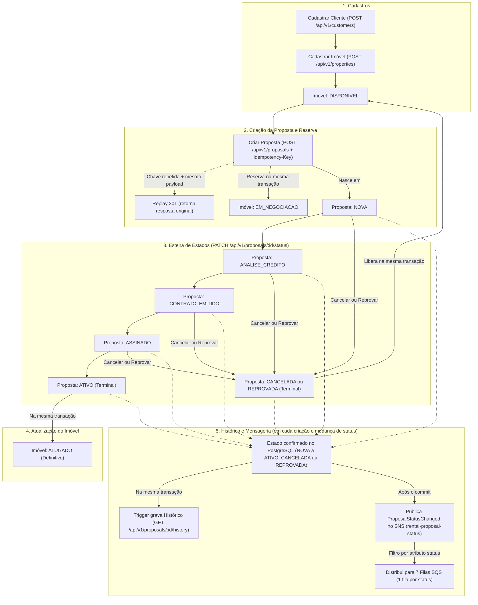

# Rental Pipeline API

API REST em NestJS, TypeScript, TypeORM e PostgreSQL para gerenciamento de clientes, imóveis e esteira de propostas de locação.

## O que é o serviço

O serviço acompanha o ciclo de vida de uma proposta de locação do início ao encerramento:

- **Clientes (`/api/v1/customers`):** cadastro e consulta de pessoas (podem atuar como proprietárias de imóveis e/ou interessadas em locação).
- **Imóveis (`/api/v1/properties`):** cadastro e consulta de unidades (`CASA` ou `APARTAMENTO`). Todo imóvel nasce `DISPONIVEL`.
- **Propostas (`/api/v1/proposals`):**
  - Ao criar uma proposta (`POST` com header `Idempotency-Key`), o imóvel é reservado atomicamente (`EM_NEGOCIACAO`) e a proposta nasce em `NOVA`.
  - A proposta avança pela esteira via `PATCH /api/v1/proposals/:id/status`:
    `NOVA → ANALISE_CREDITO → CONTRATO_EMITIDO → ASSINADO → ATIVO`
  - Antes de `ATIVO`, a proposta pode ser encerrada como `CANCELADA` ou `REPROVADA`, liberando o imóvel de volta para `DISPONIVEL`.
  - Ao chegar em `ATIVO`, o imóvel passa definitivamente para `ALUGADO`.
  - Toda criação e mudança de estado é registrada no histórico (`GET /api/v1/proposals/:id/history`) e publicada no tópico SNS `rental-proposal-status`, que distribui eventos para 7 filas SQS (uma por status).

## Fluxo de Negócio



## Pré-requisitos

- **Node.js** `24.21.0` e **npm** `11`
- **Docker** e **Docker Compose**

Se ainda não existir um arquivo `.env`, copie o exemplo:

```bash
cp -n .env.example .env
```

## Subindo o ambiente completo (Docker Compose)

Para subir toda a stack (PostgreSQL, migrations, API, LocalStack SNS/SQS e observabilidade com OpenTelemetry, Prometheus, Loki, Tempo e Grafana):

```bash
docker compose up --build -d
```

Para parar os containers mantendo os dados locais:

```bash
docker compose down
```

Para parar e apagar os volumes de dados:

```bash
docker compose down -v
```

## Subindo em modo de desenvolvimento (Node no host)

Se preferir rodar a API diretamente no host com *watch* e deixar apenas o banco e a mensageria no Docker:

```bash
docker compose up -d --wait postgres localstack
npm ci
npm run migration:run
npm run dev
```

## Acessando os serviços

| Serviço | URL / Endereço no Host | Credenciais / Observações |
| --- | --- | --- |
| **API REST** | `http://localhost:3000/api/v1` | Rotas de negócio (`customers`, `properties`, `proposals`) |
| **Swagger UI** | `http://localhost:3000/docs` | Documentação interativa (`/docs-json` para o OpenAPI JSON) |
| **Healthchecks** | `http://localhost:3000/health/live` e `/health/ready` | Sondas de vida e prontidão |
| **Grafana** | `http://localhost:3001` | Usuário: `admin` / Senha: `grafana_local` (mapeado em `3001` no host para não conflitar com a porta `3000` da API) |
| **Prometheus** | `http://localhost:9090` | Consulta de métricas técnicas |
| **LocalStack (SNS/SQS)** | `http://127.0.0.1:4566` | Tópico SNS e 7 filas SQS criadas automaticamente |
| **PostgreSQL** | `127.0.0.1:5432` | Banco `rental` |
| **PostgreSQL (Testes)** | `127.0.0.1:15432` | Banco `rental_test` (subido com `--profile test`) |

## Observabilidade e Métricas no Grafana

Ao subir a stack, o **Grafana (`http://localhost:3001`)** já inicia com todos os datasources (**PostgreSQL**, **Prometheus**, **Loki** e **Tempo**) e **3 dashboards provisionados automaticamente**, entregando visibilidade de ponta a ponta — da operação comercial à saúde transacional e rastreamento distribuído — sem expor dados sensíveis (as consultas analíticas no banco usam o papel restrito `rental_observer`, com leitura apenas em views agregadas sem PII).

### 1. Dashboard `Rental — Negócio` (Visão Executiva e Comercial)

Acompanha em tempo real o estoque, a conversão do portfólio e o volume de propostas diretamente da fonte de verdade:

| Painel / Indicador | Fonte (`proposal.*`) | Entrega de Valor |
| --- | --- | --- |
| **Imóveis por estado — estoque atual** | `proposal.property_counts` | Mostra instantaneamente quantos imóveis estão `DISPONIVEL`, `EM_NEGOCIACAO` (reservados) e `ALUGADO` (taxa de ocupação real). |
| **Propostas por estado — estoque atual** | `proposal.proposal_counts` | Fotografia completa do funil de locação nos 7 status (`NOVA`, `ANALISE_CREDITO`, `CONTRATO_EMITIDO`, `ASSINADO`, `ATIVO`, `CANCELADA`, `REPROVADA`). |
| **Novos imóveis por dia (`America/Sao_Paulo`)** | `proposal.property_registrations` | Série histórica de captação diária de novos imóveis no fuso de negócio. |
| **Encerramentos no período** | `proposal.closures` | Compara perdas de funil por desistência (`CANCELADA`) vs. reprovação (`REPROVADA`) na janela selecionada. |

### 2. Dashboard `Rental — Esteira` (Eficiência Operacional, SLA e Gargalos)

Calcula o lead time real de cada etapa da esteira com base nos intervalos do histórico auditado (`proposal.status_history`), separando etapas já concluídas de propostas que ainda estão paradas:

| Painel / Indicador | Fonte (`proposal.*`) | Entrega de Valor |
| --- | --- | --- |
| **Tempo médio concluído por etapa (s)** | `proposal.stage_durations` | Tempo médio que uma proposta leva para atravessar `NOVA`, `ANALISE_CREDITO`, `CONTRATO_EMITIDO` e `ASSINADO`. |
| **p95 concluído por etapa (s)** | `proposal.stage_durations` | Percentil 95 exato (`percentile_cont(0.95)`) de permanência por etapa, revelando gargalos e caudas longas sem distorção de média. |
| **Amostras de intervalos concluídos** | `proposal.stage_durations` | Volume de transições concluídas por etapa na janela analisada, dando contexto estatístico para a média e o `p95`. |
| **Etapas abertas — idade atual (s)** | `proposal.open_stages` | Lista quantas propostas estão abertas em cada etapa agora, com **idade média** e **maior tempo estacionado** (alerta imediato de propostas travadas). |

### 3. Dashboard `Rental — Técnico` (Confiabilidade, Concorrência e Logs ↔ Traces)

Combina métricas OpenTelemetry/Prometheus com logs estruturados no **Loki** e traces distribuídos no **Tempo**:

| Métrica / Painel | Instrumento OpenTelemetry / Fonte | Entrega de Valor |
| --- | --- | --- |
| **Requisições por segundo (req/s)** | `rental_http_requests_total` | Taxa de tráfego em tempo real segregada por rota e código HTTP (`method`, `route`, `status`). |
| **Latência HTTP `p50` / `p95` / `p99` (s)** | `rental_http_duration_seconds` | Monitoramento de experiência e SLO de tempo de resposta por endpoint. |
| **Erros `5xx` — proporção** | `rental_http_requests_total{status=~"5.."}` | Taxa real de falha interna do serviço isolada de erros de cliente/negócio (`4xx`). |
| **Conflitos de negócio por código** | `rental_business_conflicts_total` | Mede disputas de concorrência e bloqueios de regra (`PROPERTY_UNAVAILABLE`, `PROPOSAL_TRANSITION_NOT_ALLOWED`, `IDEMPOTENCY_KEY_REUSED`, `CONFLICT`). |
| **Criações, replay e transições** | `rental_proposal_outcomes_total` | Quantifica criações inéditas (`created`), replays idempotentes (`replayed`) e avanços de esteira (`transitioned`). |
| **Transações confirmadas e revertidas** | `rental_transactions_total` | Saúde transacional do PostgreSQL por operação (`commit` vs `rollback`). |
| **Duração transacional `p95` (s)** | `rental_transaction_duration_seconds` | Tempo de execução das transações no banco (incluindo espera por locks pessimistas `FOR NO KEY UPDATE` / `FOR UPDATE`). |
| **Falhas de publicação SNS** | `rental_publication_failures_total` | Visibilidade imediata caso o envio de eventos pós-commit para o SNS/LocalStack apresente instabilidade. |
| **Logs — `TraceID` abre o Tempo** | Loki (`{service_name="rental-pipeline-api"}`) + Tempo | Logs JSON correlacionados por `requestId`, `traceId` e `spanId`, permitindo abrir com 1 clique o trace distribuído completo (HTTP + queries SQL + SNS). |

## Comandos úteis

| Comando | Descrição |
| --- | --- |
| `npm run dev` | Inicia a API em modo desenvolvimento com *watch* |
| `npm run check` | Executa checagem de tipos (`typecheck`), `lint` e `build` |
| `npm test` | Executa a suíte de testes de integração (requer `postgres-test` e `localstack` ativos) |
| `npm run demo` | Executa um fluxo completo de demonstração na API em execução |
| `npm run migration:run` | Aplica as migrations pendentes no PostgreSQL |

Para rodar os testes de integração localmente:

```bash
docker compose --profile test up -d --wait postgres postgres-test localstack
npm test
```
