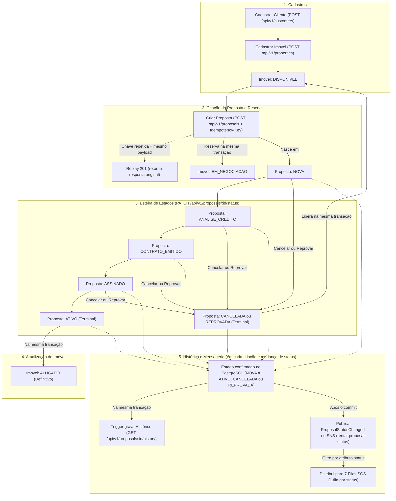

# Rental Pipeline API

API REST em NestJS, TypeScript, TypeORM e PostgreSQL para gerenciamento de clientes, imóveis e esteira de propostas de locação.

## O que é o serviço

O serviço acompanha o ciclo de vida de uma proposta de locação do início ao encerramento:

- **Clientes (`/api/v1/customers`):** cadastro e consulta de pessoas (podem atuar como proprietárias de imóveis e/ou interessadas em locação).
- **Imóveis (`/api/v1/properties`):** cadastro e consulta de unidades (`CASA` ou `APARTAMENTO`). Todo imóvel nasce `DISPONIVEL`.
- **Propostas (`/api/v1/proposals`):**
  - Ao criar uma proposta (`POST` com header `Idempotency-Key`), o imóvel é reservado atomicamente (`EM_NEGOCIACAO`) e a proposta nasce em `NOVA`.
  - A proposta avança pela esteira via `PATCH /api/v1/proposals/:id/status`:
    `NOVA → ANALISE_CREDITO → CONTRATO_EMITIDO → ASSINADO → ATIVO`
  - Antes de `ATIVO`, a proposta pode ser encerrada como `CANCELADA` ou `REPROVADA`, liberando o imóvel de volta para `DISPONIVEL`.
  - Ao chegar em `ATIVO`, o imóvel passa definitivamente para `ALUGADO`.
  - Toda criação e mudança de estado é registrada no histórico (`GET /api/v1/proposals/:id/history`) e publicada no tópico SNS `rental-proposal-status`, que distribui eventos para 7 filas SQS (uma por status).

## Fluxo de Negócio



## Pré-requisitos

- **Node.js** `24.21.0` e **npm** `11`
- **Docker** e **Docker Compose**

Se ainda não existir um arquivo `.env`, copie o exemplo:

```bash
cp -n .env.example .env
```

## Subindo o ambiente completo (Docker Compose)

Para subir toda a stack (PostgreSQL, migrations, API, LocalStack SNS/SQS e observabilidade com OpenTelemetry, Prometheus, Loki, Tempo e Grafana):

```bash
docker compose up --build -d
```

Para parar os containers mantendo os dados locais:

```bash
docker compose down
```

Para parar e apagar os volumes de dados:

```bash
docker compose down -v
```

## Subindo em modo de desenvolvimento (Node no host)

Se preferir rodar a API diretamente no host com *watch* e deixar apenas o banco e a mensageria no Docker:

```bash
docker compose up -d --wait postgres localstack
npm ci
npm run migration:run
npm run dev
```

## Acessando os serviços

| Serviço | URL / Endereço no Host | Credenciais / Observações |
| --- | --- | --- |
| **API REST** | `http://localhost:3000/api/v1` | Rotas de negócio (`customers`, `properties`, `proposals`) |
| **Swagger UI** | `http://localhost:3000/docs` | Documentação interativa (`/docs-json` para o OpenAPI JSON) |
| **Healthchecks** | `http://localhost:3000/health/live` e `/health/ready` | Sondas de vida e prontidão |
| **Grafana** | `http://localhost:3001` | Usuário: `admin` / Senha: `grafana_local` (mapeado em `3001` no host para não conflitar com a porta `3000` da API) |
| **Prometheus** | `http://localhost:9090` | Consulta de métricas técnicas |
| **LocalStack (SNS/SQS)** | `http://127.0.0.1:4566` | Tópico SNS e 7 filas SQS criadas automaticamente |
| **PostgreSQL** | `127.0.0.1:5432` | Banco `rental` |
| **PostgreSQL (Testes)** | `127.0.0.1:15432` | Banco `rental_test` (subido com `--profile test`) |

## Comandos úteis

| Comando | Descrição |
| --- | --- |
| `npm run dev` | Inicia a API em modo desenvolvimento com *watch* |
| `npm run check` | Executa checagem de tipos (`typecheck`), `lint` e `build` |
| `npm test` | Executa a suíte de testes de integração (requer `postgres-test` e `localstack` ativos) |
| `npm run demo` | Executa um fluxo completo de demonstração na API em execução |
| `npm run migration:run` | Aplica as migrations pendentes no PostgreSQL |

Para rodar os testes de integração localmente:

```bash
docker compose --profile test up -d --wait postgres postgres-test localstack
npm test
```
