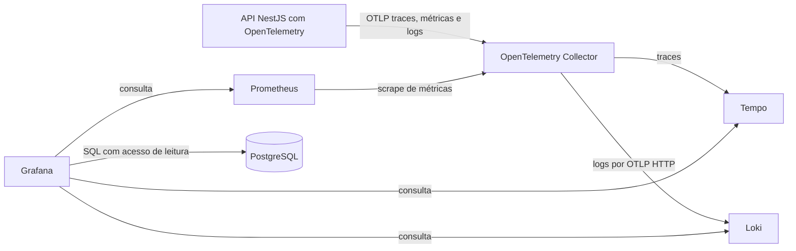

# Rental Pipeline API — Especificação funcional e técnica

Versão: 0.3  
Data: 03/11/2026  
Status: fontes da V1 preparadas; validação de execução pendente  
Fonte do desafio: [desafio.pdf](../desafio.pdf), páginas 1 e 2.

Esta visão geral preserva os requisitos e compromissos do desafio e incorpora a revisão com o responsável pelo projeto. A [ADR-002](adr/002-modelo-e-fluxos-da-v1.md) registra as decisões técnicas, a [SPEC-002](specs/002-implementacao-rental-pipeline.md) detalha modelo, contratos, fluxos e aceite, e o [plano de execução](planos/002-plano-execucao.md) organiza os incrementos. O [glossário](../GLOSSARY.md) fixa os termos de negócio.

**Definido** identifica decisões aceitas. **Proposto** identifica detalhes ainda sujeitos ao incremento correspondente. **Pendente** identifica parâmetros ainda não escolhidos. As decisões aceitas e fontes preparadas não significam aceite de execução.

A versão 0.3 incorpora a [ADR-010](adr/010-legibilidade-orm-contratos-e-mensageria.md): ORM concreto, contratos Zod, enum de propostas, controle TypeORM em `public`, SNS/SQS por estado e Compose simplificado. A [ADR-013](adr/013-reorganizacao-fisica-src.md) reorganiza `src/` (`src/infra/`, `src/modules/`, `src/shared/`) e agrupa as entidades de proposta em `src/modules/proposal/entities/`, e a [ADR-014](adr/014-remocao-do-redis.md) remove o Redis e a trava temporária da aplicação e da stack. Processo no NestJS, histórico por trigger e replay idempotente permanecem. Não há versão esperada. Código, testes e infraestrutura estão preparados; instalação, lockfile real e runtime aguardam as [pendências de aceite](planos/002-plano-execucao.md#4-pendências-para-aceite).

## Sumário

- [1. Objetivo e limites de escopo](#1-objetivo-e-limites-de-escopo)
- [2. Requisitos e rastreabilidade](#2-requisitos-e-rastreabilidade)
- [3. Decisões arquiteturais definidas](#3-decisões-arquiteturais-definidas)
- [4. Organização do código](#4-organização-do-código)
- [5. Regras e máquina de estados](#5-regras-e-máquina-de-estados)
- [6. Modelo relacional](#6-modelo-relacional)
- [7. Constraints, índices, triggers e permissões](#7-constraints-índices-triggers-e-permissões)
- [8. Transações e concorrência](#8-transações-e-concorrência)
- [9. Contratos HTTP](#9-contratos-http)
- [10. Auditoria e correlação](#10-auditoria-e-correlação)
- [11. Mensageria de estados e evolução](#11-mensageria-de-estados-e-evolução)
- [12. Observabilidade](#12-observabilidade)
- [13. Testes e critérios de aceite](#13-testes-e-critérios-de-aceite)
- [14. Migrations, execução e entrega](#14-migrations-execução-e-entrega)
- [15. ADRs e specs obrigatórias](#15-adrs-e-specs-obrigatórias)
- [16. Ambiguidades e decisões para revisão](#16-ambiguidades-e-decisões-para-revisão)
- [17. Plano incremental](#17-plano-incremental)
- [18. Referências técnicas](#18-referências-técnicas)

## 1. Objetivo e limites de escopo

Construir uma API REST que acompanhe propostas de locação desde sua criação até ativação, cancelamento ou reprovação, mantendo a disponibilidade do imóvel consistente e impedindo propostas conflitantes.

O PDF apresenta níveis Júnior, Pleno e Sênior. A profundidade de avaliação Tech Lead e os compromissos adicionais são orientações deste projeto.

### 1.1 Escopo da V1 — definido

- Cadastro e consulta de clientes com nome, CPF e e-mail; CPF/e-mail únicos.
- Cadastro e consulta de imóveis com proprietário obrigatório, endereço descritivo, tipo, descrição opcional e disponibilidade.
- Criação idempotente, consulta e transição de propostas.
- Regras de processo no NestJS e escritas atômicas no PostgreSQL.
- Prevenção de ocupação conflitante por ID de imóvel.
- Histórico de criação/mudanças por trigger, consultável pela API.
- Publicação SNS de `ProposalStatusChanged` após criação e cada transição confirmada, com sete filas SQS standard por estado.
- Testes, migrations, OpenAPI, README, CI e ambiente Docker Compose com observabilidade.

### 1.2 Fora do escopo — definido

- Validação de CPF, consulta cadastral/crédito e telefone.
- Endereço estruturado e deduplicação de unidades físicas; endereços repetidos são permitidos.
- Referência cadastral única, coproprietários e múltiplos interessados por proposta.
- Entidade de contrato, valor, vigência, documentos, assinatura e integração financeira reais.
- Autenticação, autorização, frontend e múltiplas organizações.
- Edição/exclusão cadastral e transferência de propriedade por endpoint.
- Expiração automática de reserva, reabertura de terminal e encerramento de locação ativa.
- Redis e trava distribuída temporária (removidos pela [ADR-014](adr/014-remocao-do-redis.md)).
- Controle de versão do consumidor, outbox, workers, consumidores, reenvio posterior e entrega durável. SNS/SQS integram a V1, com LocalStack no ambiente local.

As etapas de crédito, emissão e assinatura são mudanças de estado solicitadas pelo consumidor; não executam os sistemas externos correspondentes. A normalização para dígitos não inclui validador de CPF.

## 2. Requisitos e rastreabilidade

### 2.1 Funcionalidades e regras do PDF

| ID | Requisito | Origem | Classificação no PDF | Tratamento na V1 |
| --- | --- | --- | --- | --- |
| RF-01 | Cadastrar cliente. | p. 1, funcionalidades | Obrigatório | Incluir. |
| RF-02 | Cadastrar imóvel inicialmente disponível. | p. 1, funcionalidades | Obrigatório | Incluir; aplicação força o estado e banco tem default `DISPONIVEL`. |
| RF-03 | Criar proposta vinculando cliente e imóvel. | p. 1, funcionalidades | Obrigatório | Incluir. |
| RF-04 | Reservar o imóvel ao criar a proposta. | p. 1, funcionalidades | Obrigatório | Alterar para `EM_NEGOCIACAO` na mesma transação. |
| RF-05 | Atualizar o estado pela sequência definida. | p. 1, funcionalidades | Obrigatório | Validar pela matriz TypeScript na aplicação. |
| RF-06 | Cancelar ou reprovar antes de `ATIVO`. | p. 1, funcionalidades | Obrigatório | Incluir para os quatro estados anteriores. |
| RN-01 | Aceitar nova proposta somente para imóvel disponível. | p. 1, regras | Obrigatório | Validação/reserva transacional na aplicação e proteção estrutural PostgreSQL. |
| RN-02 | Impedir saltos de etapas. | p. 1, regras | Obrigatório | Rejeitar pares ausentes da máquina de estados. |
| RN-03 | Alterar permanentemente o imóvel para alugado ao ativar. | p. 1, regras | Obrigatório | `ATIVO` é terminal; imóvel permanece `ALUGADO`. |
| RN-04 | Liberar imóvel após cancelamento ou reprovação. | p. 1, regras | Obrigatório | Atualização transacional para `DISPONIVEL`. |
| DF-01 | Impedir propostas simultâneas conflitantes. | p. 1, diferenciais | Opcional | Incluído por decisão do projeto. |
| DF-02 | Expor histórico com data, hora, estado anterior e novo. | p. 1, diferenciais | Opcional | Incluído por decisão do projeto. |
| DF-03 | Simular evento na ativação. | p. 2, continuação dos diferenciais | Opcional | Ampliado pela ADR-010: `ProposalStatusChanged` via SNS para criação e todos os estados confirmados. |
| DF-04 | Fornecer Dockerfile e Docker Compose. | p. 2, continuação dos diferenciais | Opcional | Incluído, também com observabilidade. |

### 2.2 Qualidade e entrega do PDF

| ID | Item | Origem | Evidência esperada |
| --- | --- | --- | --- |
| QA-01 | Organização, nomenclatura e separação de responsabilidades. | p. 2, avaliação | Estrutura modular, código legível e decisões explicadas. |
| QA-02 | Validações, HTTP status e mensagens descritivas. | p. 2, avaliação | DTOs validados, erros padronizados e testes HTTP. |
| QA-03 | Testes automatizados das regras. | p. 2, avaliação | Testes de integração, conforme compromisso adicional do projeto. |
| QA-04 | README com configuração, execução e testes. | p. 2, avaliação | Instruções verificadas a partir de ambiente limpo. |
| QA-05 | Justificar tecnologias, concorrência e integridade. | p. 2, avaliação | Resumo no README e ADRs vinculados. |
| ENT-01 | Disponibilizar código em repositório público no GitHub. | p. 2, entrega | Repositório preparado para avaliação. |
| ENT-02 | Enviar o link ao recrutador. | p. 2, entrega | Ação do responsável pelo projeto ao finalizar; não automatizada pela API. |

O PDF permite escolher linguagem, framework e banco. Não exige NestJS, PostgreSQL, Swagger, ADRs ou observabilidade. Essas escolhas fazem parte do escopo adicional definido pelo projeto.

### 2.3 Compromissos adicionais definidos

| ID | Compromisso |
| --- | --- |
| PR-01 | Node.js, TypeScript, NestJS, TypeORM e PostgreSQL. |
| PR-02 | Um serviço de negócio e três módulos: Customer, Property e Proposal. |
| PR-03 | Um PostgreSQL com schemas `customer`, `property` e `proposal`. |
| PR-04 | Máquina de estados na aplicação, reserva atômica e índice único parcial no banco. |
| PR-05 | OpenTelemetry, Grafana, Prometheus, Loki e Tempo. |
| PR-06 | Indicadores de negócio calculados a partir do PostgreSQL. |
| PR-07 | Testes de integração, incluindo concorrência real. |
| PR-08 | Migrations, Swagger/OpenAPI, README, ADRs e specs vinculadas. |
| PR-09 | SNS/SQS por estado; evolução documentada para Transactional Outbox e recuperação durável. |
| PR-10 | Desenvolvimento incremental, com revisão da base antes da implementação. |

| ID | Compromisso confirmado na revisão |
| --- | --- |
| PR-11 | Removido pela [ADR-014](adr/014-remocao-do-redis.md): coordenação de transição exclusivamente no PostgreSQL, sem Redis. |
| PR-12 | Idempotência de criação com chave obrigatória e resposta de sucesso na mesma transação PostgreSQL. |
| PR-13 | Um único trigger de histórico, sem lógica de processo ou coluna de versão. |

## 3. Decisões arquiteturais definidas

| Tema | Decisão vigente |
| --- | --- |
| Arquitetura | Monólito modular NestJS com Customer, Property e Proposal (`src/infra/`, `src/modules/`, `src/shared/`). |
| Persistência | Cinco entidades/três repositórios TypeORM; PostgreSQL com três schemas de negócio e controle técnico em `public`. |
| Regras de processo | Matriz de estados, reserva e sincronização no NestJS. |
| Integridade estrutural | Enum PostgreSQL para propostas/histórico, checks restantes, FKs, unicidades, índice parcial e transações. |
| Histórico | Um trigger de registro, sem validação de transições ou alteração de imóvel. |
| Concorrência | `READ COMMITTED`; ordem imóvel → proposta, com chave de idempotência adquirida antes na criação. |
| Versão | Sem `expectedVersion`, `version` ou `allowed_transitions`. |
| Redis | Removido pela [ADR-014](adr/014-remocao-do-redis.md); sem dependência, container ou trava externa. |
| Idempotência | POST de proposta com chave obrigatória, replay de sucessos e retenção sem expiração automática. |
| Eventos | SNS `ProposalStatusChanged` após commit; sete filas SQS por status, sem entrega durável da aplicação. |
| Observabilidade | OpenTelemetry, Grafana, Prometheus, Loki e Tempo. |
| Entrega | Compose completo, CI, documentação e verificação com banco real. |

Versões diretas/imagens e valores operacionais estão fixados nos arquivos. Compatibilidade da árvore resolvida, instalação e execução dependem do lockfile real e dos checks; não há capacidade medida.

## 4. Organização do código

A raiz de `src/` contém `main.ts`, `application.ts`, `app.module.ts` e os diretórios `src/infra/` (`config/`, `database/`, `health/`, `observability/`), `src/modules/` e `src/shared/` ([ADR-013](adr/013-reorganizacao-fisica-src.md)). Os três módulos sob `src/modules/` contêm controllers, schemas Zod, DTOs inferidos, interfaces, serviços, entidades (`src/modules/proposal/entities/` para as três tabelas de proposta) e repositórios concretos. Serviços coordenam regras sem banco direto; repositórios executam ORM e SQL necessário com parâmetros nomeados. A transação usa repositório vinculado ao seu manager. Estados/tipos, eventos e códigos de erro reutilizam enums; a matriz permanece em TypeScript.

Customer e Property não dependem de Proposal. Proposal coordena as referências e locks entre schemas do mesmo banco; esse acoplamento é intencional e não deve virar dependência circular de módulos ou exposição de entidades ORM nos contratos HTTP.

Configuração, migrations, sondas de saúde, HTTP compartilhado e observabilidade são componentes técnicos. A idempotência fica junto dos casos de uso de Proposal. Não criar Ports & Adapters artificiais, repositório/Unit of Work genéricos, CQRS, event sourcing, automapper, barramento próprio ou abstrações para uma evolução ainda não implementada.

Artefatos documentais vigentes:

- [ADR-002](adr/002-modelo-e-fluxos-da-v1.md): contexto, decisão, alternativas e consequências.
- [SPEC-002](specs/002-implementacao-rental-pipeline.md): requisitos verificáveis e contratos.
- [Plano de execução](planos/002-plano-execucao.md): incrementos e dependências.
- [Glossário](../GLOSSARY.md): conceitos de negócio, sem decisões de implementação.

Criar arquivos de código apenas quando necessários ao incremento, sem gerar toda uma árvore de classes antecipadamente.

## 5. Regras e máquina de estados

### 5.1 Disponibilidade dos imóveis

| Estado | Significado | Aceita nova proposta? |
| --- | --- | --- |
| `DISPONIVEL` | Sem proposta que reserve ou ocupe o imóvel. | Sim. |
| `EM_NEGOCIACAO` | Reservado por uma proposta em andamento. | Não. |
| `ALUGADO` | Associado a proposta ativa. | Não. |

### 5.2 Transições das propostas

| Origem | Destinos permitidos |
| --- | --- |
| `NOVA` | `ANALISE_CREDITO`, `CANCELADA`, `REPROVADA` |
| `ANALISE_CREDITO` | `CONTRATO_EMITIDO`, `CANCELADA`, `REPROVADA` |
| `CONTRATO_EMITIDO` | `ASSINADO`, `CANCELADA`, `REPROVADA` |
| `ASSINADO` | `ATIVO`, `CANCELADA`, `REPROVADA` |
| `ATIVO`, `CANCELADA`, `REPROVADA` | Nenhum. |

Os 12 pares são definidos na aplicação. Criação gera histórico `null → NOVA`, sem constituir um par da matriz. Repetição do mesmo estado retorna conflito.

### 5.3 Invariantes dos caminhos da API

- Imóvel nasce disponível e proposta nasce nova, vinculada a cliente e imóvel existentes.
- Reserva, proposta, chave/resposta e histórico de criação confirmam ou revertem juntos.
- Há no máximo uma proposta fora de `CANCELADA`/`REPROVADA` por imóvel, incluindo a ativa.
- Proposta em andamento corresponde a imóvel reservado; ativação corresponde a alugado.
- Cancelamento/reprovação liberam o imóvel na mesma transação; terminais não têm saída.
- Cliente/imóvel de uma proposta são imutáveis e cada mudança confirmada tem um histórico.
- Cliente pode propor para vários imóveis; nova tentativa após cancelamento/reprovação cria outra proposta e usa outra chave.
- Reserva não expira e não há proibição adicional de proposta para imóvel próprio.

A aplicação valida o estado atual sob lock. Sem versão esperada, dois comandos podem confirmar em sequência se ambos forem válidos nos estados encontrados. Escrita direta por SQL não é caminho suportado para o processo.

## 6. Modelo relacional

O detalhamento de colunas, nulabilidade e convenções está na [SPEC-002](specs/002-implementacao-rental-pipeline.md#4-modelo-relacional).

| Tabela | Finalidade |
| --- | --- |
| `customer.customers` | Cliente com nome, CPF/e-mail únicos e criação. |
| `property.properties` | Imóvel com proprietário obrigatório, endereço, tipo, descrição, disponibilidade e datas. |
| `proposal.proposals` | Interessado, imóvel, estado e datas da esteira; sem versão. |
| `proposal.status_history` | ID próprio, proposta, estados anterior/novo, instante e correlação técnica opcional. |
| `proposal.idempotency_requests` | Chave única, payload normalizado, retrato da resposta e criação. |

Um cliente possui vários imóveis e pode iniciar várias propostas. Um imóvel recebe propostas ao longo do tempo; apenas uma pode reservá-lo ou ocupá-lo. Proposta possui histórico desde sua criação.

CPF é string normalizada para dígitos, sem validação de 11 posições/checksum; e-mail é normalizado com trim e minúsculas. Endereço não é único. Campos JSON usam `camelCase`, banco usa `snake_case`, recursos usam UUID e instantes usam UTC.

Não há entidade de contrato, cadastro separado de proprietário, `reference_code`, `allowed_transitions` ou `version`.

## 7. Constraints, índices, triggers e permissões

O banco garante referências, campos obrigatórios, valores possíveis e unicidades. O índice único parcial de `property_id` em propostas considera todos os estados exceto `CANCELADA` e `REPROVADA`, incluindo `ATIVO`. Não criar unicidade permanente de cliente + imóvel nem de endereço.

Existe um único trigger: `AFTER INSERT OR UPDATE` da proposta para registrar criação e mudança efetiva de estado. Ele não valida a matriz, reserva/libera imóvel ou define transições. Histórico tem ID próprio, é append-only para a aplicação e participa do mesmo commit/rollback.

`rental_migrator` evolui os objetos; `rental_app` executa as leituras/escritas necessárias aos casos de uso com permissões limitadas; `rental_observer` lê apenas views/agregações de observabilidade. O trigger usa privilégios controlados para que a aplicação não receba escrita direta no histórico.

Restrições de coluna protegem IDs, criação e referências imutáveis de proposta. Não alegar que permissões/checks substituem a validação do processo: SQL direto ainda pode contornar a sequência e a sincronização.

Nomes de constraints, índices, tipos e política de escrita estão na [SPEC-002](specs/002-implementacao-rental-pipeline.md#5-constraints-índices-e-permissões).

## 8. Transações e concorrência

Criação e transição usam `READ COMMITTED`, com a mesma conexão e contexto transacional para todas as escritas. Ordem de locks: imóvel → proposta; na criação, antes disso, adquirir a unicidade da chave de idempotência.

**Criação:** validar header/payload, adquirir a chave, recuperar replay se existente, verificar referências, bloquear/reservar imóvel, inserir proposta, obter histórico pelo trigger, salvar a resposta e confirmar. Nenhuma linha de chave pode ser confirmada sem resposta preenchida. Falha desfaz o conjunto.

**Transição:** abrir transação, bloquear imóvel e proposta, reler estado, validar a matriz na aplicação, atualizar proposta/imóvel e obter histórico pelo trigger, confirmar, registrar duração transacional e publicar SNS do estado confirmado.

Não chamar rede/publicador durante locks PostgreSQL.

Configurar prazos de operação/locks/instruções. Não repetir conflitos de negócio ou commit com resultado desconhecido. A criação permite retry seguro com a mesma chave; não há framework de retries automáticos na V1. Detalhes e cenários de disputa estão na [SPEC-002](specs/002-implementacao-rental-pipeline.md#8-fluxos-transacionais).

## 9. Contratos HTTP

O contrato completo, exemplos válidos de entrada/saída e erros estão na [SPEC-002](specs/002-implementacao-rental-pipeline.md#9-contratos-http).

| Operação | Corpo de entrada |
| --- | --- |
| POST `/api/v1/customers` | `name`, `cpf`, `email`. |
| POST `/api/v1/properties` | `ownerId`, `address`, `type`, `description` opcional. |
| POST `/api/v1/proposals` | `customerId`, `propertyId`; header `Idempotency-Key` obrigatório. |
| PATCH `/api/v1/proposals/{id}/status` | Apenas `status`. |

POST retorna `201` com `location` no corpo, junto aos campos do recurso; GET/PATCH retornam `200` sem esse campo. Estado desconhecido/payload inválido é `400`; referência inexistente é `404`; imóvel indisponível, estado repetido/transição inválida e chave reutilizada com outro payload são `409`.

Falhas internas retornam `500 INTERNAL_ERROR` com `Não foi possível concluir a operação.`, sem detalhes da causa.
A sonda `/health/ready` preserva `503` com o mesmo código e mensagem genéricos, conforme a
[SPEC-012](specs/012-erros-internos-genericos.md).

Mesma chave/payload reproduz o `201` e o corpo completo original, incluindo `location`, mesmo após a proposta avançar. Esse corpo é salvo na mesma transação da criação. Outra chave passa novamente pela disponibilidade. Ausência de chave é `400`. Não há replay para PATCH ou cadastros.

Há GET individual/listagem de clientes, imóveis e propostas e GET do histórico por proposta. Filtros: imóveis por `status`, `type`, `ownerId`; propostas por `status`, `customerId`, `propertyId`. Paginação `page`/`limit`, padrões 1/20, limite máximo 100, envelope `data`/`meta` com totais. Histórico é crescente por ID; demais listas, por criação/ID decrescentes.

Swagger `/docs`, OpenAPI `/docs-json`, vida `/health/live` e prontidão `/health/ready`. Readiness depende do PostgreSQL/inicialização, não da disponibilidade da observabilidade. Nenhum endpoint edita/exclui cadastros.

## 10. Auditoria e correlação

O único trigger registra uma linha na criação e em cada update que altera o estado. O instante é `NEW.status_entered_at`, já usado pela aplicação na proposta. Histórico tem ID `bigint` próprio e não usa versão.

O contexto técnico de request/trace é local à transação, parametrizado e não pode vazar no pool. As respostas de histórico mostram estados e instante, sem copiar dados pessoais ou atribuir um operador autenticado inexistente. IDs bigint são strings decimais no HTTP.

O trigger garante acompanhamento da escrita e rollback, não a validade de uma mudança feita diretamente por SQL. Aplicação não insere o histórico em paralelo. Ver [SPEC-002](specs/002-implementacao-rental-pipeline.md#10-histórico-e-evento).

## 11. Mensageria de estados e evolução

O caso de uso publica `ProposalStatusChanged` no SNS para uma criação nova (`NOVA`) e cada PATCH confirmado. O envio é aguardado após commit e métrica transacional. Replay, rejeição e rollback não publicam. Payload inclui IDs, estado, versão de schema e instante PostgreSQL, sem dados pessoais. O ID `ProposalStatusChanged:<proposalId>:<status>` pressupõe que o fluxo não revisita estados.

LocalStack 4.10.0 provisiona tópico e sete filas SQS standard, com filtros de assinatura por `MessageAttributes.status`, entrega raw e policies restritas ao tópico. O SDK SNS oficial está fixado em 3.1161.0; ARN/região/endpoint/prazo vêm do ambiente e credenciais da cadeia padrão AWS. SNS não integra startup/readiness. Não há consumidor na API.

Falha gera log/métrica e preserva o resultado HTTP confirmado. Há janela de perda após commit e não há reenvio posterior. Transporte standard permite duplicação/reordenação; consumidores devem deduplicar por `eventId`. Outbox e worker continuam como evolução para entrega durável. Contrato na [SPEC-002](specs/002-implementacao-rental-pipeline.md#10-histórico-e-evento) e detalhes na [SPEC-010](specs/010-legibilidade-orm-contratos-e-mensageria.md#mensageria).

## 12. Observabilidade

### 12.1 Arquitetura de coleta



Inicializar a instrumentação antes dos imports da aplicação e dos módulos que serão instrumentados. Combinar instrumentação HTTP/PostgreSQL com spans e métricas dos casos de uso. Versões e instrumentos estão fixados no código; a ingestão real ainda precisa ser verificada. [Referência: OpenTelemetry para Node.js](https://opentelemetry.io/docs/languages/js/getting-started/nodejs/).

O logger deve produzir JSON em stdout e integrar os registros ao pipeline de logs OpenTelemetry. O Collector encaminha logs ao endpoint OTLP HTTP nativo do Loki; a configuração deve habilitar os metadados estruturados necessários. [Referência: ingestão OTLP no Loki](https://grafana.com/docs/loki/latest/send-data/otel/).

### 12.2 Indicadores de negócio

PostgreSQL é a fonte de verdade. Grafana consulta views SQL com papel observer limitado, sem acesso direto aos dados pessoais de clientes; implementação preparada, execução pendente.

| Indicador | Fonte | Definição proposta |
| --- | --- | --- |
| Quantidade atual de imóveis por estado. | `property.properties` | Contagem atual agrupada por estado; mostrar zero para estados sem registros. |
| Imóveis novos por dia. | `property.properties.created_at` | Contagem por dia de cadastro no fuso `America/Sao_Paulo`. |
| Quantidade atual de propostas por estado. | `proposal.proposals` | Contagem atual agrupada pelos sete estados. |
| Tempo médio por etapa. | `proposal.status_history` | Média dos intervalos concluídos em cada uma das quatro etapas não terminais. |
| p95 do tempo por etapa. | `proposal.status_history` | Percentil 95 dos mesmos intervalos individuais concluídos. |
| Cancelamentos. | Histórico com destino `CANCELADA`. | Quantidade de transições de cancelamento no período. |
| Reprovações. | Histórico com destino `REPROVADA`. | Quantidade de transições de reprovação no período. |
| Idade das propostas em aberto. | `proposals.status_entered_at` | Tempo desde a entrada na etapa atual, exibido separadamente dos tempos concluídos. |

Para tempo de permanência, ordenar todo o histórico de cada proposta por ID crescente e usar o instante da próxima mudança como saída da etapa. O intervalo pertence ao estado registrado em `to_status` na entrada.

Calcular os pares de entrada e saída antes de filtrar a janela do dashboard. Proposto: atribuir o intervalo ao período em que sua saída ocorreu, com limites `[início, fim)`. Incluir saídas por cancelamento ou reprovação, pois também encerram permanência na etapa anterior.

Excluir estados terminais e intervalos ainda abertos da média e do p95 de etapas concluídas. Sem amostras concluídas, mostrar ausência de dados; não apresentar duração zero. Calcular o p95 sobre os intervalos originais, por exemplo com `percentile_cont(0.95)`, e não pela média de percentis de grupos.

Contagens atuais representam o estoque no momento da consulta; o filtro de período se aplica a cadastros, saídas de etapas e encerramentos. A distinção deve aparecer nos títulos ou descrições dos painéis.

O papel de Grafana deve ter apenas acesso de leitura aos objetos necessários. [Referência: datasource PostgreSQL no Grafana](https://grafana.com/docs/grafana/latest/datasources/postgres/configure/).

### 12.3 Indicadores técnicos

| Indicador | Instrumento proposto | Definição |
| --- | --- | --- |
| Latência HTTP p50, p95 e p99. | Histograma de duração HTTP, em segundos. | Do recebimento ao término da resposta; agregação por rota normalizada e método. |
| Requisições por segundo. | Contador de requisições. | Taxa de requisições, com janela inicial de cinco minutos. |
| Taxa de erros do serviço. | Contagem HTTP por status. | Respostas `5xx` divididas pelo total no período; exibir `4xx` separadamente. |
| Conflitos de reserva. | Contador de conflitos de negócio. | Requisições rejeitadas por indisponibilidade ou índice parcial, contabilizadas uma vez por resultado. |
| Duração das transações. | Histograma por operação e resultado. | Do início de cada tentativa transacional ao commit ou rollback, incluindo espera de locks. |
| Rollbacks e retentativas. | Contadores por operação e motivo controlado. | Apoio ao diagnóstico de contenção e falhas. |
| Falhas da publicação SNS. | `rental_publication_failures`, por status. | Falhas observadas após criação ou transição confirmada. |
| Replay/conflito de idempotência. | Contador por resultado controlado. | Distinguir replay de criação efetiva; não usar a chave como label. |

Percentis HTTP são calculados a partir dos histogramas agregados, sem média de percentis por processo. Instrumentos e buckets estão definidos no código e nos dashboards, sem validação de ingestão nesta sessão.

Usar labels com cardinalidade limitada: serviço, ambiente, operação, método, rota normalizada, estado e resultado. Não usar CPFs, IDs, e-mails, endereços, chaves de idempotência, request IDs, trace IDs ou URLs com identificadores como labels Prometheus.

O código HTTP `409` representa conflito de negócio; sua ocorrência não deve ser contabilizada como erro `5xx` do serviço. Métricas da operação distinguem tentativas internas de seu resultado final.

### 12.4 Logs e traces

Campos mínimos propostos nos logs: timestamp, nível, mensagem ou nome do evento, serviço, ambiente, `requestId`, `traceId` e `spanId` quando disponíveis. Erros internos incluem código e stack no destino de logs.

Não registrar payloads completos, CPFs, e-mails, endereços, senhas, tokens ou parâmetros SQL pessoais. IDs técnicos de recursos podem aparecer nos eventos e logs necessários ao diagnóstico, sem virar labels de métricas ou labels indexados de alta cardinalidade no Loki.

No ambiente local, manter amostragem de traces suficiente para reproduzir o fluxo completo de avaliação. Correlacionar um erro ou evento no Loki com o trace no Tempo por links configurados no Grafana.

### 12.5 Dashboards e disponibilidade

Provisionar três dashboards no repositório:

1. Negócio: disponibilidade, novos imóveis, propostas por estado e encerramentos.
2. Esteira: permanência média e p95 por etapa, quantidade de amostras e propostas ainda abertas.
3. Técnico: tráfego, latência, erros, conflitos, transações e links para logs e traces.

Dashboards devem iniciar com os datasources configurados. Período inicial proposto: sete dias para negócio e uma hora para visão técnica, permitindo alteração pelo avaliador. Mostrar timezone e unidade dos gráficos de duração.

Falha na telemetria não deve impedir operações de negócio. Usar exportação assíncrona, filas limitadas e flush no encerramento controlado. A prontidão da API depende do banco e da inicialização da aplicação; não exige disponibilidade de Grafana, Loki ou Tempo.

Views/dashboards estão preparados com histórico por ID e replay separado de nova proposta. Indicadores, ingestão e visualização aguardam validação real; os parâmetros não são metas de capacidade ou SLOs.

## 13. Testes e critérios de aceite

A [SPEC-002](specs/002-implementacao-rental-pipeline.md#11-critérios-de-aceite) enumera AC-01 a AC-25, e o plano associa os critérios aos incrementos.

| Nível | Evidência |
| --- | --- |
| Integração PostgreSQL | Migrations, FKs/checks/índices, histórico, permissões, rollback, 49 pares da matriz, concorrência de reservas/transições e idempotência atomicamente com o negócio. |
| HTTP e mensageria | Contratos Zod/OpenAPI, normalização, erros, `location`/replay, paginação, saúde, jornada e SNS/SQS real via LocalStack após commit; seis suítes de integração preparadas ([ADR-011](adr/011-testes-apenas-integracao.md) e [ADR-014](adr/014-remocao-do-redis.md)). |

Concorrência exige conexões independentes e barreiras/sinalização. Não usar SQLite ou apenas mock para afirmar garantias transacionais. Exercitar mesma chave e chaves diferentes, primeira transação confirmada/revertida, resposta perdida e disputas de ativação/cancelamento/nova reserva.

Não testar como garantia vigente que SQL direto valida a máquina de estados; ela pertence à aplicação. Não afirmar rejeição por versão antiga, pois não há versão esperada. A entrega documental verifica links, JSON e coerência; testes de aplicação ficam nos incrementos que criam o código.

## 14. Migrations, execução e entrega

### 14.1 Migrations

Uma sequência TypeORM cria schemas, cinco tabelas de negócio/apoio, FKs, checks, índices, único trigger de histórico, views e permissões. Não inserir matriz de transições ou criar triggers de processo. `synchronize: false`.

Bootstrap versionado e repetível cria banco, papéis e o schema necessário ao controle de migrations. O controle fica em `public.typeorm_migrations`; apenas o migrator recebe os privilégios técnicos. A migration inicial cria os três schemas de negócio e o enum `proposal.proposal_status`. Evoluir por novas migrations, sem reescrever versões aplicadas; documentar reversões e perda de dados quando pertinente.

Datas/estado da proposta e imóvel são coordenados explicitamente pela aplicação; histórico só pelo trigger. Não adicionar `@VersionColumn`, subscriber ou mecanismo ORM que replique esses efeitos. Seeds são opcionais, separados de estrutura, com clientes proprietários antes de imóveis e propostas pelos fluxos suportados.

### 14.2 Containers

| Componente | Responsabilidade |
| --- | --- |
| `api` | Única aplicação NestJS de negócio. |
| `postgres` | Banco transacional único e volume persistente. |
| `migrate` | Execução pontual das migrations antes da API. |
| `localstack` | SNS/SQS local, tópico e sete filas filtradas por estado. |
| `postgres-test` | Banco temporário isolado no perfil `test`. |
| `otel-collector`, `prometheus`, `loki`, `tempo`, `grafana` | Coleta, armazenamento e visualização de observabilidade. |

Compose declara nove serviços padrão e `postgres-test` no perfil `test`, sem anchors/tooling/cache npm. API depende somente do sucesso de `migrate`, que aguarda PostgreSQL saudável. SNS e telemetria não bloqueiam startup/readiness. Ambientes segregam credenciais; Dockerfile multi-stage exige lockfile e processo sem privilégios. Shutdown inclui HTTP, banco, SNS e exportadores.

### 14.3 Configuração e comandos

Versões diretas/imagens e comandos estão definidos; falta gerar/versionar o lockfile real. `.env.example` documenta conexões, prazos PostgreSQL/operação, telemetria e AWS/SNS. `.env` existente recebeu somente chaves ausentes, preservando valores. Node/npm nativos executam desenvolvimento/checks; containers usam hosts internos e credenciais segregadas.

Após preparar o lockfile e o ambiente, o comando documentado para a stack é:

```bash
docker compose up --build
```

Os arquivos da V1 e da stack estão preparados, mas a execução ainda não foi validada nesta sessão. O [README](../README.md) documenta preparação do lockfile, URLs, portas, credenciais apenas locais, volumes e recriação com perda de dados.

### 14.4 CI e documentação

CI deve executar instalação por lockfile, análise estática, build e verificações relevantes, com PostgreSQL e LocalStack reais onde necessários. README deve reproduzir a execução e demonstrar idempotência, conflito, fluxo e observabilidade, incluindo SNS/SQS LocalStack, sem prometer integração financeira real ou entrega durável.

Preparar arquivos para repositório público sem credenciais. Publicação e envio do link ao recrutador permanecem atividades posteriores do responsável.

## 15. ADRs e specs obrigatórias

### 15.1 Regra de desenvolvimento — definida

Por determinação do responsável pelo projeto, todo desenvolvimento deve gerar uma nova ADR acompanhada da spec correspondente. A regra abrange funcionalidades, correções, refatorações, testes, configuração, infraestrutura e documentação.

1. Antes de implementar, criar a ADR em `docs/adr/NNN-titulo.md` e criar ou atualizar a spec da mesma entrega. A spec pode ser uma seção identificada deste documento ou um arquivo próprio em `docs/specs/`.
2. A spec deve registrar objetivo, escopo, requisitos, comportamento esperado e critérios de aceite verificáveis.
3. A ADR deve registrar contexto, decisão, alternativas consideradas, consequências e status, além de um link para o arquivo e, quando aplicável, a seção exata da spec correspondente.
4. A spec deve conter o link de volta para a ADR. Manter ambos os documentos sincronizados com as mudanças de escopo e as decisões tomadas durante o desenvolvimento.
5. Concluir a entrega somente com a ADR e a spec presentes, vinculadas e consistentes com o resultado e com as verificações realizadas. Entregar a mudança e os dois documentos em conjunto.

Os registros são numerados continuamente desde 001; a ADR e a spec da entrega usam o mesmo identificador. Para uma nova ADR, usar o próximo número após o maior registro existente: 022. Temas propostos sem arquivo não reservam identificadores. O status de uma decisão fornecida pelo responsável difere do status dos novos detalhes propostos; esta regra não altera o status das demais propostas da especificação.

### 15.2 Catálogo de ADRs

O catálogo contém somente ADRs criadas, com suas specs correspondentes. Os temas sem registro próprio da proposta inicial estão preservados na seção histórica abaixo, sem identificadores de ADR.

| ADR | Tema | Situação vigente |
| --- | --- | --- |
| [ADR-001](adr/001-desenvolvimento-com-adr-e-spec.md) | Nova ADR e spec por desenvolvimento. | Vigente; [SPEC-001](specs/001-desenvolvimento-com-adr-e-spec.md) e regra na seção 15.1. |
| [ADR-002](adr/002-modelo-e-fluxos-da-v1.md) | Modelo, contratos e fluxos revisados da V1. | Aceita; parcela de Redis substituída pela ADR-014; [SPEC-002](specs/002-implementacao-rental-pipeline.md) e [plano](planos/002-plano-execucao.md). |
| [ADR-003](adr/003-fundacao-nestjs-postgres-redis.md) | Fundação NestJS, banco, Redis opcional e saúde. | Decisão aceita; Redis removido pela ADR-014 e caminhos em `src/infra/` pela ADR-013; [SPEC-003](specs/003-fundacao-aplicacao.md). |
| [ADR-004](adr/004-banco-e-historico.md) | Banco, histórico e permissões. | Aceita; SQL nos serviços/controle técnico substituídos pela ADR-010; [SPEC-004](specs/004-banco-e-historico.md). |
| [ADR-005](adr/005-cadastros-e-http.md) | Cadastros e HTTP. | Aceita; ORM, Zod e contratos revisados pela ADR-010 e conflito cadastral genérico pela ADR-015; [SPEC-005](specs/005-cadastros-e-http.md). |
| [ADR-006](adr/006-propostas-idempotentes.md) | Reserva e replay transacional. | Mantida; snapshot inclui location, criação publica SNS e header validado via pipe na ADR-018; [SPEC-006](specs/006-propostas-idempotentes.md). |
| [ADR-007](adr/007-esteira-e-trava-temporaria.md) | Esteira e trava Redis. | Esteira mantida; evento substituído por SNS na ADR-010 e trava Redis removida pela ADR-014; [SPEC-007](specs/007-esteira-e-trava-temporaria.md). |
| [ADR-008](adr/008-observabilidade.md) | OTel, views e dashboards. | Mantida; falhas SNS por estado na ADR-010 e remoção da métrica/painel Redis na ADR-014; [SPEC-008](specs/008-observabilidade.md). |
| [ADR-009](adr/009-entrega-e-verificacao.md) | Entrega reproduzível. | Aceita; tooling/perfil na ADR-010, integração na ADR-011, sem Redis na ADR-014 e README direto na ADR-017/ADR-021; [SPEC-009](specs/009-entrega-e-verificacao.md). |
| [ADR-010](adr/010-legibilidade-orm-contratos-e-mensageria.md) | ORM, Zod, enums, SNS/SQS e simplificação. | Vinte pontos tratados nas fontes; estrutura ajustada pelas ADRs 013/016/018 e Redis removido pela ADR-014; [SPEC-010](specs/010-legibilidade-orm-contratos-e-mensageria.md). |
| [ADR-011](adr/011-testes-apenas-integracao.md) | Manter exclusivamente testes de integração com node:test. | Aceita; seis suítes de integração vigentes após ADR-014; [SPEC-011](specs/011-testes-apenas-integracao.md). |
| [ADR-012](adr/012-erros-internos-genericos.md) | Erros internos genéricos sem exposição de infraestrutura. | Aceita; fontes e testes preparados, execução npm/HTTP pendente; [SPEC-012](specs/012-erros-internos-genericos.md). |
| [ADR-013](adr/013-reorganizacao-fisica-src.md) | Reorganização física de `src/` sem Ports & Adapters artificiais. | Aceita; fontes atualizadas em `src/infra/` e `src/modules/proposal/entities/`, execução pendente; [SPEC-013](specs/013-reorganizacao-fisica-src.md). |
| [ADR-014](adr/014-remocao-do-redis.md) | Remoção do Redis e da trava distribuída temporária. | Aceita; código, config, Compose, dashboard, testes e docs atualizados, execução pendente; [SPEC-014](specs/014-remocao-do-redis.md). |
| [ADR-015](adr/015-conflito-generico-cadastro-cliente.md) | Erro genérico de conflito no cadastro de clientes. | Aceita; `CONFLICT` substitui códigos por CPF/e-mail, execução pendente; [SPEC-015](specs/015-conflito-generico-cadastro-cliente.md). |
| [ADR-016](adr/016-solid-transacoes-repositorios-servicos.md) | Aplicação pragmática de SOLID em transações, repositórios e serviços. | Aceita; SRP/OCP aplicados em `DatabaseService`, repositórios e publisher, execução pendente; [SPEC-016](specs/016-solid-transacoes-repositorios-servicos.md). |
| [ADR-017](adr/017-simplificacao-readme.md) | Simplificação do `README.md`. | Aceita e concluída; [SPEC-017](specs/017-simplificacao-readme.md). |
| [ADR-018](adr/018-validacao-idempotency-key-zod-pipe.md) | Validação do header `Idempotency-Key` diretamente via `ZodValidationPipe`. | Aceita; `idempotency-key.ts` removido e erros unificados em `VALIDATION_ERROR`; [SPEC-018](specs/018-validacao-idempotency-key-zod-pipe.md). |
| [ADR-019](adr/019-gitignore-artefatos-locais.md) | Ignorar `desafio.pdf` e `skills-lock.json` no `.gitignore`. | Aceita e concluída; [SPEC-019](specs/019-gitignore-artefatos-locais.md). |
| [ADR-020](adr/020-geracao-package-lock.md) | Geração e versionamento do `package-lock.json` para build Docker. | Aceita e concluída; [SPEC-020](specs/020-geracao-package-lock.md). |
| [ADR-021](adr/021-fluxograma-fluxo-projeto-readme.md) | Fluxograma Mermaid do fluxo do projeto no `README.md`. | Aceita e concluída; [SPEC-021](specs/021-fluxograma-fluxo-projeto-readme.md). |

### 15.3 Temas da proposta inicial

Os temas abaixo faziam parte do desenho inicial, sem arquivos de ADR próprios. Sua situação histórica não altera as decisões vigentes do catálogo.

| Tema proposto | Situação vigente |
| --- | --- |
| Monólito modular Customer, Property e Proposal. | Mantido; consolidação na ADR-002. |
| Banco único com três schemas e FKs entre módulos. | Mantido; consolidação na ADR-002. |
| Máquina de estados no banco, desenho anterior. | Substituído pela ADR-002: regras na aplicação. |
| `READ COMMITTED`, reserva atômica, índice parcial e ordem de locks. | Mantido com detalhamento na SPEC-002. |
| Reserva/sincronização em triggers, proposta anterior. | Descartado pela ADR-002. |
| Auditoria por trigger. | Redefinido pela ADR-002: ID próprio, sem versão. |
| Versão esperada obrigatória, proposta anterior. | Descartado pela ADR-002. |
| Evento simulado após commit e evolução Outbox/SNS/SQS. | Substituído pela ADR-010: SNS/SQS por estado, ainda sem outbox/entrega durável. |
| Negócio no PostgreSQL e telemetria OpenTelemetry. | Mantido; indicadores detalhados na fase de observabilidade. |
| Estados em `text` com `CHECK`, sem enum nativo. | Substituído parcialmente pela ADR-010: proposta/histórico usam enum; imóvel mantém checks e matriz fica na aplicação. |
| V1 sem Redis/mensageria, desenho anterior. | Substituído pelas ADRs 002/010: Redis temporário e SNS/SQS por estado. |

## 16. Ambiguidades e decisões para revisão

| ID | Tema | Resultado da revisão |
| --- | --- | --- |
| DEC-01 | Dados de cliente. | Definido: ID, nome, CPF, e-mail e criação. |
| DEC-02 | Identidade cadastral. | Definido: CPF e e-mail únicos independentemente; normalizar ambos. |
| DEC-03 | Identidade do imóvel. | Definido: ID, proprietário, endereço, tipo e descrição; sem referência única. |
| DEC-04 | CPF, telefone e dados financeiros. | CPF incluído, sem validador; telefone/valor/vigência fora. |
| DEC-05 | Propostas por cliente. | Definido: vários imóveis; exclusividade é por imóvel. |
| DEC-06 | Nova tentativa. | Definido: nova proposta e nova chave após cancelamento/reprovação, se disponível. |
| DEC-07 | Encerrar locação ativa. | Fora da V1; `ATIVO` terminal e imóvel alugado. |
| DEC-08 | Prazo da reserva. | Definido: não expira automaticamente. |
| DEC-09 | Repetir status. | Definido: `409`, sem histórico/evento adicional. |
| DEC-10 | Versão esperada. | Dispensada; validar contra o estado atual sob lock. |
| DEC-11 | Reserva e sincronização. | Definido: aplicação NestJS, na transação do caso de uso. |
| DEC-12 | Histórico. | Definido: trigger só de registro, criação incluída, sem versão ou operador autenticado. |
| DEC-13 | Idempotência de criação. | Definido: chave obrigatória, replay de sucesso no PostgreSQL, sem expiração automática. |
| DEC-14 | Mensageria. | Definido na ADR-010: SNS por criação/transição, sete filas por status; falha preserva commit/HTTP e não há outbox/reenvio. |
| DEC-15 | Fuso do dia de negócio. | Definido na ADR-008: `America/Sao_Paulo`, instantes UTC; execução pendente. |
| DEC-16 | Duração de etapas abertas. | Definido na ADR-008: concluídas na média/p95; idade aberta separada; execução pendente. |
| DEC-17 | Autenticação. | Fora da V1. |
| DEC-18 | Edição/exclusão cadastral. | Fora da V1; único endpoint de alteração é o status de proposta. |
| DEC-19 | SLOs/volume/capacidade. | Pendente; não inventar metas ou alegações. |
| DEC-20 | Versões, TTLs e timeouts. | Definidos na ADR-003/configuração; instalação/compatibilidade em execução ainda pendentes. |
| DEC-21 | SQL direto. | Não é caminho suportado de processo; não recebe validação da matriz. |
| DEC-22 | Papéis e propriedade. | Definido: um cliente pode possuir/propor; um proprietário obrigatório por imóvel. |
| DEC-23 | Tipos, descrição e endereço. | Definido: apartamento/casa, descrição opcional, endereço livre sem unicidade. |
| DEC-24 | Proposta para imóvel próprio. | Não acrescentar restrição nessa V1. |
| DEC-25 | Redis. | Removido na ADR-014: transições coordenadas exclusivamente pela transação PostgreSQL. |
| DEC-26 | Consultas. | Definido: filtros acordados e paginação 1/20, máximo 100, histórico crescente por ID. |

As pendências operacionais serão resolvidas nos incrementos indicados. Não reabrir decisões de escopo apenas por preferência de ferramenta ou por limitações já aceitas. Mudança real de requisito exige atualizar ADR/spec.

## 17. Plano incremental

O [plano de execução](planos/002-plano-execucao.md) define dependências, tarefas e critérios de conclusão:

1. Fundação: NestJS, configuração, PostgreSQL/Redis e ferramentas.
2. Banco: cinco tabelas, constraints/índices, histórico e permissões.
3. Cadastros e consultas.
4. Criação de proposta com reserva e idempotência.
5. Transições, trava Redis e publicação por estado.
6. Observabilidade e indicadores verificados.
7. Entrega reproduzível com Compose, CI, Swagger e README.

As fontes dos sete incrementos e dos vinte pontos da revisão estão preparadas. A renumeração desde 001 e a
revisão Ponytail ULTRA final estão concluídas nas fontes. Oito casos de configuração passaram isoladamente com
Node 26; instalação por npm falhou por DNS e o daemon Docker segue inacessível. Instalação/lockfile, compatibilidade
com Node 24, tipos/lint/build, suítes npm, bootstrap/migrations, stack/dashboards, SIGTERM e jornada limpa aguardam
execução e correção de eventuais falhas. O [plano](planos/002-plano-execucao.md#4-pendências-para-aceite) separa
esses aceites dos arquivos existentes e registra as verificações parciais realizadas.

## 18. Referências técnicas

Fonte de requisitos: [PDF original](../desafio.pdf). Tecnologias e profundidade adicionais são escolhas do projeto, não imposições do desafio.

- [ADR-002 — decisões aceitas](adr/002-modelo-e-fluxos-da-v1.md).
- [SPEC-002 — implementação e aceite](specs/002-implementacao-rental-pipeline.md).
- [Plano de execução](planos/002-plano-execucao.md).
- [PostgreSQL — transações e isolamento](https://www.postgresql.org/docs/current/transaction-iso.html).
- [PostgreSQL — índices parciais](https://www.postgresql.org/docs/current/indexes-partial.html).
- [PostgreSQL — triggers](https://www.postgresql.org/docs/current/trigger-definition.html).
- [PostgreSQL — locks e deadlocks](https://www.postgresql.org/docs/current/explicit-locking.html).
- [PostgreSQL — SECURITY DEFINER](https://www.postgresql.org/docs/current/sql-createfunction.html).
- [TypeORM — transações](https://typeorm.io/docs/transactions/).
- [Redis — SET](https://redis.io/docs/latest/commands/set/).
- [Redis — trava com TTL e token](https://redis.io/docs/latest/develop/clients/patterns/distributed-locks/).
- [OpenTelemetry — Node.js](https://opentelemetry.io/docs/languages/js/getting-started/nodejs/).
- [Grafana — datasource PostgreSQL](https://grafana.com/docs/grafana/latest/datasources/postgres/configure/).
- [Loki — ingestão OpenTelemetry](https://grafana.com/docs/loki/latest/send-data/otel/).

As referências dão suporte aos mecanismos; não substituem os testes reais previstos na spec. Parâmetros ainda não medidos não representam promessa de capacidade.
