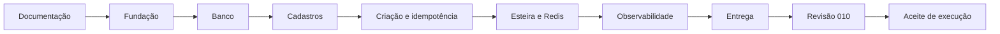

# Plano de execução — Rental Pipeline API V1

Data: 03/11/2026  
Status: fontes da V1 preparadas; vinte pontos e revisão final concluídos nas fontes; aceite de execução pendente  
ADR base: [ADR-002](../adr/002-modelo-e-fluxos-da-v1.md).  
Spec base: [SPEC-002](../specs/002-implementacao-rental-pipeline.md).  
Revisão: [ADR-010](../adr/010-legibilidade-orm-contratos-e-mensageria.md) e
[SPEC-010](../specs/010-legibilidade-orm-contratos-e-mensageria.md).  
Erros internos: [ADR-012](../adr/012-erros-internos-genericos.md) e
[SPEC-012](../specs/012-erros-internos-genericos.md).  
Estrutura `src/`: [ADR-013](../adr/013-reorganizacao-fisica-src.md) e
[SPEC-013](../specs/013-reorganizacao-fisica-src.md).  
Remoção do Redis: [ADR-014](../adr/014-remocao-do-redis.md) e
[SPEC-014](../specs/014-remocao-do-redis.md).  
Conflito cadastral: [ADR-015](../adr/015-conflito-generico-cadastro-cliente.md) e
[SPEC-015](../specs/015-conflito-generico-cadastro-cliente.md).  
SOLID e simplificação: [ADR-016](../adr/016-solid-transacoes-repositorios-servicos.md) e
[SPEC-016](../specs/016-solid-transacoes-repositorios-servicos.md).  
README: [ADR-017](../adr/017-simplificacao-readme.md) e
[SPEC-017](../specs/017-simplificacao-readme.md).  
Idempotency-Key no pipe Zod: [ADR-018](../adr/018-validacao-idempotency-key-zod-pipe.md) e
[SPEC-018](../specs/018-validacao-idempotency-key-zod-pipe.md).  
Gitignore e commits: [ADR-019](../adr/019-gitignore-artefatos-locais.md) e
[SPEC-019](../specs/019-gitignore-artefatos-locais.md).  
Visão geral: [Especificação funcional e técnica](../especificacao-tecnica.md).

## 1. Regra de execução

Cada desenvolvimento exige ADR/spec vinculadas antes da implementação, conforme [AGENTS.md](../../AGENTS.md),
[ADR-001](../adr/001-desenvolvimento-com-adr-e-spec.md) e a
[regra de documentação](../especificacao-tecnica.md#151-regra-de-desenvolvimento--definida).
ADR/spec 010 reúne os vinte pontos da revisão e antecedeu suas alterações; não há outro par por subitem.
Os dez pares ADR/spec originais foram acrescidos dos pares 011 a 019 ([ADR-011](../adr/011-testes-apenas-integracao.md) a
[ADR-019](../adr/019-gitignore-artefatos-locais.md)).
Os dezenove pares seguem contínuos desde 001; o próximo identificador é 020.

Fontes preparadas e aceite são estados distintos. Não marcar um incremento como validado antes de executar e
registrar seus checks. Migrations aplicadas não são reescritas; a inicial foi ajustada porque ainda não foi aplicada.

## 2. Dependências e estado atual

Os sete incrementos estão em arquivos: aplicação, cinco entidades, três repositórios, cadastros/consultas,
idempotência, esteira, histórico, Redis, SNS/SQS local, observabilidade, testes, Compose e CI. A revisão preparou
os vinte pontos; a renumeração (19) e a revisão Ponytail ULTRA final (20) estão concluídas nas fontes.
O incremento 012 remove a classificação externa de infraestrutura, sanitiza 5xx, mantém readiness 503 genérico
e prepara cenários HTTP de privacidade/correlação, sem alterar as garantias de negócio.

Não há `package-lock.json` real. Em 04/11, Node 26.13.0/npm 11.20.0 foram encontrados no NVM, fora do PATH;
Node 24 não foi encontrado. Uma tentativa npm falhou por DNS do registry (`EAI_AGAIN`), sem instalar dependências,
e Docker confirmou acesso negado ao daemon. Não houve repetição após os bloqueios. Oito casos de configuração
passaram isoladamente com Node 26 nativo; os MJS passaram em verificação de sintaxe. Compilação, suítes npm,
migrations e stack não foram executadas; esses checks parciais não comprovam compatibilidade com Node 24.

## 3. Incrementos e fontes preparadas

### 0. Consolidação documental — concluída

ADR/spec 002, plano, visão geral e glossário registram o modelo. A revisão 010 sincroniza os contratos técnicos
vigentes e preserva o glossário de negócio, sem adicionar implementação a ele.

### 1. Fundação da aplicação

[ADR-003](../adr/003-fundacao-nestjs-postgres-redis.md) /
[SPEC-003](../specs/003-fundacao-aplicacao.md): NestJS, configuração, PostgreSQL obrigatório, Redis opcional,
saúde, shutdown e comandos. Revisão 010 move controle TypeORM para `public`, remove tooling Docker e concentra
saúde no HTTP real. Critérios F-01 a F-08 aguardam execução.

### 2. Estrutura do banco e histórico

[ADR-004](../adr/004-banco-e-historico.md) /
[SPEC-004](../specs/004-banco-e-historico.md): três schemas, cinco tabelas, enum de proposta, FKs, unicidades,
índice parcial com `ATIVO`, trigger de histórico, views e permissões. Duas migrations preparadas; nenhuma aplicada.
Aceite estrutural: AC-02/03, AC-20 e AC-23.

### 3. Cadastros e consultas

[ADR-005](../adr/005-cadastros-e-http.md) /
[SPEC-005](../specs/005-cadastros-e-http.md): clientes/imóveis, filtros/paginação e erros. Revisão 010 usa
entidades/repositórios, Zod, enums e `location` no corpo. CPF segue somente dígitos, sem teto/checksum.
Aceite: AC-01 a AC-04 e AC-21/22 aplicáveis.

### 4. Criação de proposta e idempotência

[ADR-006](../adr/006-propostas-idempotentes.md) /
[SPEC-006](../specs/006-propostas-idempotentes.md): claim, reserva, proposta, histórico e snapshot `201` na mesma
transação, replay e conflito de payload. Revisão 010 mantém conexão/locks com repositório transacional e publica
`NOVA` após commit. Aceite: AC-05 a AC-11, AC-16 e AC-20/21 aplicáveis.

### 5. Esteira, trava Redis e ativação

[ADR-007](../adr/007-esteira-e-trava-temporaria.md) /
[SPEC-007](../specs/007-esteira-e-trava-temporaria.md): 12 transições, locks imóvel → proposta, disponibilidade e
lease Redis com token/TTL e fail open. Revisão 010 substitui log de ativação por SNS para cada estado confirmado.
Aceite: AC-07 e AC-12 a AC-20, mais roteamento/ordem/limites da SPEC-010.

### 6. Observabilidade

[ADR-008](../adr/008-observabilidade.md) /
[SPEC-008](../specs/008-observabilidade.md): OTel, logs JSON, Collector/Prometheus/Loki/Tempo/Grafana,
views com observer e três dashboards. Métrica de publicação agora cobre SNS por estado. Aceite: AC-24,
privacidade/correlação, ingestão e visualização reais, sem bloquear negócio/readiness.

### 7. Entrega reproduzível

[ADR-009](../adr/009-entrega-e-verificacao.md) /
[SPEC-009](../specs/009-entrega-e-verificacao.md): Swagger, demo por endpoints, CI e instruções. Revisão 010
deixa dez serviços padrão no Compose e PostgreSQL temporário no perfil `test`; npm executa no host. A
[ADR-011](../adr/011-testes-apenas-integracao.md) mantém exclusivamente as nove suítes de integração em
`test/integration/*.spec.ts` com `node:test`. Suítes npm e integrações não foram executadas. Aceite: AC-25 e
evidências dos demais ACs.

## 4. Pendências para aceite

Executar a [sequência do README](../../README.md#verificar) quando Node/npm, Docker e rede estiverem acessíveis.
Não substituir as evidências abaixo por leitura textual, mocks ou apenas `compose config`.

- [ ] Gerar/versionar `package-lock.json` real com npm; conferir versões/peers e compatibilidade da árvore resolvida.
- [ ] Executar `npm ci`, `npm run lint:fix` e `npm run check` (tipos, lint e build limpo); corrigir falhas.
- [ ] Executar E-01 a E-05 da SPEC-012 na integração HTTP: PG/rede/5xx com corpo próprio devem manter
  mensagem genérica e correlação; readiness real mantém 503 e liveness 200; Swagger e regras de domínio conferem.
- [ ] Executar bootstrap PostgreSQL limpo e reaplicação sem perda de dados; conferir papéis, grants, DDL restrito
  e `public.typeorm_migrations`. Corrigir falhas de SQL/bootstrap descobertas e repetir os checks afetados.
- [ ] Aplicar as duas migrations via CLI; conferir enum, cinco tabelas, índices, trigger, views e rollback isolado.
  Corrigir falhas de migration e comprovar ausência de escrita direta do app no histórico.
- [ ] Executar as seis suítes de integração com PostgreSQL real e SNS/SQS LocalStack: contratos HTTP/OpenAPI,
  invariantes, replay, concorrência, rollback, privilégios e publicação/filtragem após commit.
  Corrigir falhas de integração, preservando isolamento do banco `_test` e dos recursos temporários de mensageria.
- [ ] Construir e subir a imagem/stack; conferir migration antes da API e continuidade sem SNS/telemetria.
- [ ] Conferir ingestão OTLP/Prometheus/Loki/Tempo e os três dashboards com dados conhecidos, correlação e
  permissões observer; JSON/YAML válidos não comprovam painéis nem indicadores.
- [ ] Verificar shutdown de HTTP/pool/SNS/exportadores e SIGTERM do container.
- [ ] Reproduzir jornada em ambiente limpo: cadastros, replay, conflito, cancelamento, nova proposta e ativação;
  confrontar README/Swagger e registrar evidências por critério F/AC.
- [x] Concluir renumeração desde 001 (item 19), com links/âncoras, pares, catálogo e referências conferidos.
- [x] Executar revisão Ponytail final (item 20): fontes conectadas, duplicações/resíduos corrigidos e limites registrados.

Checks já registrados nos itens: contratos/imports/ordem das operações por leitura e Python, JSON/YAML, shell,
AST/hook local simulado, limite textual de 120 colunas e configuração Compose padrão/perfil `test`. A consolidação
documental e a renumeração conferiram links/âncoras, exemplos JSON, vínculos nos dois sentidos e dez pares
contínuos desde 001. A revisão final reconferiu imports/exports locais, JSON/YAML, limite de colunas, shell e hook
simulado, sem rede. `node --check` passou nos dois MJS. Os oito casos de configuração passaram com Node 26 nativo
em cópia temporária do teste que altera somente o caminho do import. Não substituem tipos, lint, build, suíte npm
e compatibilidade com Node 24, nem SQL/SDK AWS/integração reais. A SPEC-010 registra contagens e resultados exatos.

## 5. Conclusão de cada incremento

Concluir somente com ADR/spec vinculadas, comportamento correspondente, checks relevantes aprovados e documentação
com resultados reais. Corrigir falhas descobertas antes de aceitar; mudança de requisito/contrato exige rever os
documentos da decisão. Não acrescentar auth, outbox, checksum de CPF ou endereço estruturado para fechar o aceite.
Publicar o repositório e enviar o link ao recrutador continuam atividades posteriores do responsável.
