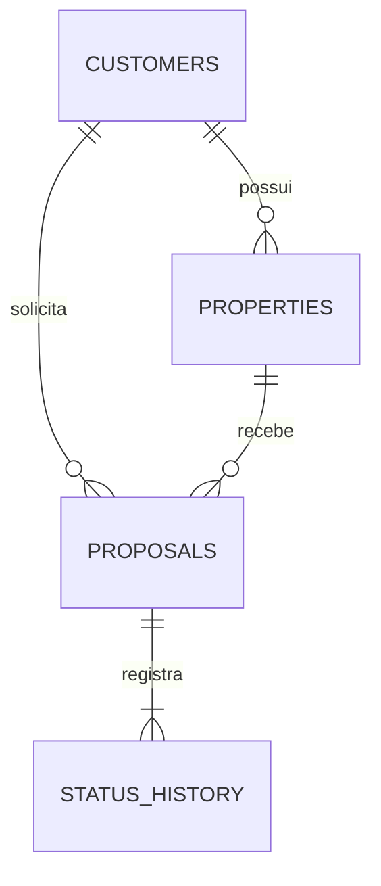

# SPEC-002 — Implementação da Rental Pipeline API V1

Data: 03/11/2026  
Status: fontes da V1 preparadas; validação de execução pendente  
ADR: [ADR-002 — Modelo e fluxos da V1](../adr/002-modelo-e-fluxos-da-v1.md).  
Plano: [Plano de execução](../planos/002-plano-execucao.md).  
Visão geral e requisitos do desafio: [Especificação funcional e técnica](../especificacao-tecnica.md).  
Termos: [Glossário](../../GLOSSARY.md).

## 1. Objetivo e precedência

Implementar uma API REST que cadastre clientes e imóveis, crie propostas com reserva atômica e acompanhe a esteira até ativação, cancelamento ou reprovação. A criação de proposta deve reproduzir o resultado original quando repetida com a mesma chave de idempotência.

Esta spec detalha as decisões da ADR-002 e substitui o modelo técnico da versão 0.1 da visão geral nos temas revisados. A visão geral mantém requisitos, compromissos de entrega, observabilidade e a regra de documentação. O plano define a ordem de execução; não altera estes contratos.

Os incrementos 003 a 009 e a [revisão 010](../adr/010-legibilidade-orm-contratos-e-mensageria.md) prepararam código, testes e infraestrutura. Esta spec descreve os contratos vigentes; presença dos arquivos não significa aceite. Instalação, lockfile real, build, testes, migrations e stack continuam pendentes conforme o plano.

## 2. Escopo

### Incluído

- Monólito NestJS/TypeScript, cinco entidades/três repositórios TypeORM, PostgreSQL e módulos Customer, Property e Proposal.
- Schemas `customer`, `property` e `proposal` no mesmo banco e uma sequência de migrations.
- Cadastro e consultas; CPF e e-mail únicos; proprietário obrigatório por imóvel.
- Regras de processo no NestJS, transações e proteção estrutural no banco.
- Histórico por um único trigger de registro, incluindo criação.
- Idempotência apenas na criação de proposta, com replay de sucessos persistidos no PostgreSQL.
- `ProposalStatusChanged` via SNS após criação e cada transição confirmada; sete filas SQS standard por status.
- Contratos Zod/OpenAPI, integração PostgreSQL/SNS-SQS e testes HTTP ([SPEC-011](011-testes-apenas-integracao.md) e [SPEC-014](014-remocao-do-redis.md)).
- Docker Compose, CI, README e observabilidade já previstos na visão geral.

### Fora da V1

- Validador de CPF, consulta cadastral ou de crédito; telefone e dados financeiros.
- Endereço estruturado, deduplicação de unidades físicas e referência cadastral única.
- Entidade de contrato, documentos, vigência, valor de aluguel ou assinatura real.
- Autenticação, autorização, frontend e múltiplas organizações.
- Edição/exclusão cadastral e transferência de propriedade por endpoint.
- Coproprietários e múltiplos interessados na mesma proposta.
- Regra adicional contra proposta para imóvel próprio.
- Expiração de reserva, reabertura de proposta terminal e encerramento de locação ativa.
- Versão esperada, tabela de transições no banco e triggers de regra de processo.
- Redis e trava distribuída temporária (removidos pela [ADR-014](../adr/014-remocao-do-redis.md)).
- Outbox, workers, consumidores, reenvio posterior e entrega durável do evento. SNS/SQS e LocalStack fazem parte da V1; integração financeira real não faz.

## 3. Responsabilidades e limites

| Componente | Responsabilidade |
| --- | --- |
| HTTP/DTOs | Schemas Zod validam/normalizam formato e limites, rejeitam campos desconhecidos e alimentam tipos inferidos/OpenAPI. |
| Aplicação NestJS | Validar a matriz de transições, adquirir locks, coordenar proposta e imóvel, idempotência e publicação após commit. |
| Persistência | Entidades e repositórios concretos; transação usa repositório vinculado ao seu `EntityManager`, sem repositório global. SQL necessário usa parâmetros nomeados; serviços não acessam o banco diretamente. |
| PostgreSQL | FKs, unicidade, checks de valores, locks, commit/rollback e trigger de histórico. |
| Trigger de histórico | Registrar os valores da criação ou mudança de estado, sem consultar uma máquina de estados ou alterar imóveis. |

Customer e Property não dependem de Proposal. Proposal coordena as referências e escritas necessárias no banco compartilhado, sem dependência circular entre módulos. Estados e a matriz podem ser funções/tipos TypeScript sem dependência de NestJS ou TypeORM.

Criar somente os arquivos necessários a cada incremento. Não introduzir Ports & Adapters artificiais ([ADR-013](../adr/013-reorganizacao-fisica-src.md)), repositório genérico, Unit of Work genérico, CQRS, event sourcing, automapper, framework de idempotência ou barramento próprio. A idempotência pertence aos casos de uso de Proposal.

## 4. Modelo relacional

### Convenções

- Tabelas/colunas em `snake_case`; JSON em `camelCase`.
- IDs dos recursos de negócio em UUID, gerados pelo servidor. IDs internos do histórico em `bigint` identity.
- Instantes em `timestamptz`, conexão UTC e representação HTTP ISO 8601 UTC.
- `synchronize: false`; alterações estruturais somente por migrations.
- Propostas e histórico usam o enum PostgreSQL `proposal.proposal_status`; tipo/estado de imóvel mantêm `text` com `CHECK`. A matriz de transições continua apenas na aplicação.
- Controle TypeORM em `public.typeorm_migrations`, separado dos três schemas de negócio.
- FKs com `ON DELETE RESTRICT` e `ON UPDATE RESTRICT`.
- Não há `version`, exclusão lógica ou endpoints de exclusão.



### 4.1 `customer.customers`

| Coluna | Tipo | Nulo? | Regra |
| --- | --- | --- | --- |
| `id` | `uuid` | Não | PK; gerado pelo servidor. |
| `name` | `varchar(150)` | Não | Trim; conteúdo obrigatório, até 150 caracteres. |
| `cpf` | `text` | Não | Normalizado para somente dígitos; não vazio e único. |
| `email` | `varchar(254)` | Não | Trim, minúsculas, formato de e-mail e até 254 caracteres; único após normalização. |
| `created_at` | `timestamptz` | Não | Instante de criação. |

CPF é uma string: preservar zeros iniciais e remover caracteres que não sejam dígitos. Não exigir 11 posições, calcular dígitos verificadores, rejeitar sequências repetidas ou consultar serviço cadastral. Tipo string, obrigatoriedade e conteúdo não vazio após normalização continuam sendo validações de entrada; não são um validador de CPF.

### 4.2 `property.properties`

| Coluna | Tipo | Nulo? | Regra |
| --- | --- | --- | --- |
| `id` | `uuid` | Não | PK; gerado pelo servidor. |
| `owner_id` | `uuid` | Não | FK para `customer.customers(id)`. |
| `address` | `varchar(500)` | Não | Trim, não vazio, até 500 caracteres; sem unicidade. |
| `type` | `text` | Não | `APARTAMENTO` ou `CASA`. |
| `description` | `varchar(1000)` | Sim | Opcional; trim; até 1.000 caracteres. Ausência, null ou texto vazio normalizado vira null. |
| `status` | `text` | Não | `DISPONIVEL`, `EM_NEGOCIACAO` ou `ALUGADO`; default `DISPONIVEL`. |
| `created_at` | `timestamptz` | Não | Instante de criação. |
| `updated_at` | `timestamptz` | Não | Instante da última alteração da disponibilidade. |

O proprietário precisa existir antes do cadastro do imóvel. Um cliente pode possuir vários imóveis e iniciar propostas para outros ou para os próprios imóveis; não haverá distinção cadastral de papéis nem proibição adicional.

### 4.3 `proposal.proposals`

| Coluna | Tipo | Nulo? | Regra |
| --- | --- | --- | --- |
| `id` | `uuid` | Não | PK; gerado pelo servidor. |
| `customer_id` | `uuid` | Não | FK para `customer.customers(id)`; interessado; imutável. |
| `property_id` | `uuid` | Não | FK para `property.properties(id)`; imutável. |
| `status` | `proposal.proposal_status` | Não | Um dos sete estados; default `NOVA`. |
| `status_entered_at` | `timestamptz` | Não | Entrada no estado atual. |
| `created_at` | `timestamptz` | Não | Criação, imutável. |
| `updated_at` | `timestamptz` | Não | Última mudança de estado. |

Na criação, os três instantes são iguais. Na transição, a aplicação obtém um instante após os locks e o usa em `status_entered_at` e `updated_at`. Pode obter esse instante por `clock_timestamp()` na conexão transacional. O trigger reutiliza `NEW.status_entered_at` no histórico; não cria outro horário para a mesma mudança.

### 4.4 `proposal.status_history`

| Coluna | Tipo | Nulo? | Regra |
| --- | --- | --- | --- |
| `id` | `bigint generated always as identity` | Não | PK; ordenação crescente do histórico. |
| `proposal_id` | `uuid` | Não | FK para `proposal.proposals(id)`. |
| `from_status` | `proposal.proposal_status` | Sim | Null na criação; estado anterior nas mudanças. |
| `to_status` | `proposal.proposal_status` | Não | Estado registrado na criação ou atualização. |
| `changed_at` | `timestamptz` | Não | Mesmo instante da entrada no estado na proposta. |
| `request_id` | `uuid` | Sim | Correlação técnica da requisição. |
| `trace_id` | `varchar(32)` | Sim | Correlação com trace quando disponível. |

Um único trigger `AFTER INSERT OR UPDATE` registra a criação e, em updates, apenas quando `OLD.status IS DISTINCT FROM NEW.status`. A criação pelo caminho da API gera `null → NOVA`. O trigger não decide se uma mudança é válida. A aplicação não insere histórico em paralelo.

Não expor CPF/e-mail no histórico. O papel da aplicação pode consultar, mas não inserir, alterar ou excluir diretamente o histórico. Sem autenticação, não existe `actorId`.

### 4.5 `proposal.idempotency_requests`

| Coluna | Tipo | Nulo? | Regra |
| --- | --- | --- | --- |
| `key` | `varchar(255)` | Não | PK; chave opaca do consumidor, exclusiva do endpoint de criação de proposta. |
| `request_payload` | `jsonb` | Não | Objeto normalizado com `customerId` e `propertyId`. |
| `response_body` | `jsonb` | Sim, durante a transação | Retrato da resposta HTTP `201`; deve estar preenchido antes do commit. |
| `created_at` | `timestamptz` | Não | Instante de aquisição da chave. |

O campo temporariamente nulo permite adquirir a unicidade da chave antes das escritas de negócio. Essa linha permanece não confirmada até proposta, reserva, histórico e resposta estarem prontos. Não existe estado pendente persistido, worker ou lease de idempotência. O caso de uso não pode confirmar uma linha sem resposta; falhas revertem a linha inteira. Esse comportamento deve ser coberto por teste de integração.

O status HTTP de replay é sempre `201`, pois somente sucessos deste endpoint são retidos. O campo `location` faz parte do corpo salvo e é reproduzido junto aos demais campos, sem reconstrução a partir do estado atual. Não adicionar TTL ou limpeza automática na V1.

## 5. Constraints, índices e permissões

| Nome de referência | Garantia |
| --- | --- |
| `uq_customers_cpf` | CPF normalizado único. |
| `uq_customers_email_normalized` | E-mail único por `lower(btrim(email))`. |
| `fk_properties_owner` | Proprietário existente. |
| `fk_proposals_customer` / `fk_proposals_property` | Referências existentes e protegidas contra exclusão. |
| `fk_status_history_proposal` | Histórico vinculado a uma proposta existente. |
| `uq_proposals_property_occupied` | No máximo uma proposta ocupante por imóvel. |
| `pk_idempotency_requests` | Uma aquisição confirmada por chave. |

O índice de ocupação será:

```sql
CREATE UNIQUE INDEX uq_proposals_property_occupied
ON proposal.proposals (property_id)
WHERE status NOT IN ('CANCELADA', 'REPROVADA');
```

`ATIVO` permanece no índice. Não criar unicidade permanente em `(customer_id, property_id)`: ela impediria novas tentativas legítimas após cancelamento ou reprovação.

O enum limita status de proposta/histórico; checks limitam status/tipo de imóvel e campos obrigatórios não vazios. Não duplicam a matriz. Não há índice único de endereço ou `reference_code`. Os nomes de constraints e índices usados no mapeamento HTTP devem ser estáveis.

Índices de consulta: clientes, imóveis e propostas por `(created_at DESC, id DESC)`; imóveis por `owner_id`; propostas por cliente e por imóvel, seguidos da ordenação de criação; histórico por `(proposal_id, id)`. Índices adicionais de status/tipo dependem de consultas e planos de execução, não devem ser criados por antecipação.

Papéis:

- `rental_migrator`: proprietário dos objetos e responsável por migrations.
- `rental_app`: leituras e inserts necessários; atualiza disponibilidade/datas do imóvel, estado/datas da proposta e a resposta da chave de idempotência. Não altera cliente/imóvel de propostas existentes, IDs ou datas de criação. Não faz DDL, delete ou truncate.
- `rental_observer`: leitura apenas das views/agregações necessárias à observabilidade, sem dados pessoais.

O trigger pode usar função `SECURITY DEFINER`, proprietário controlado, `search_path` fixo e objetos qualificados para gravar o histórico sem dar esse privilégio direto a `rental_app`. Não haverá triggers de reserva, sincronização, validação de processo ou timestamps.

Essas permissões não transformam o banco em validador do processo. SQL direto com permissões de escrita ainda pode violar a sequência ou a relação entre os estados; não é caminho de negócio suportado.

## 6. Estados e invariantes

| Origem | Destinos permitidos |
| --- | --- |
| `NOVA` | `ANALISE_CREDITO`, `CANCELADA`, `REPROVADA` |
| `ANALISE_CREDITO` | `CONTRATO_EMITIDO`, `CANCELADA`, `REPROVADA` |
| `CONTRATO_EMITIDO` | `ASSINADO`, `CANCELADA`, `REPROVADA` |
| `ASSINADO` | `ATIVO`, `CANCELADA`, `REPROVADA` |
| `ATIVO`, `CANCELADA`, `REPROVADA` | Nenhum. |

Há 12 pares permitidos. A matriz existe uma única vez no código de domínio da aplicação; não há tabela de configuração no banco. As etapas não iniciam serviços externos.

Nos caminhos da API:

1. Imóvel nasce disponível e proposta nasce nova.
2. Criar proposta exige imóvel disponível e o reserva na mesma transação.
3. Proposta não terminal corresponde a imóvel `EM_NEGOCIACAO`.
4. Ativar corresponde a imóvel `ALUGADO`, permanentemente na V1.
5. Cancelar ou reprovar libera o imóvel na mesma transação.
6. Identidade e referências da proposta são imutáveis.
7. Cada criação/mudança confirmada gera um registro de histórico; rollback não deixa efeito parcial.
8. Estado igual, salto ou alteração de terminal é conflito, sem histórico ou evento adicional.
9. Um cliente pode ter propostas para imóveis diferentes. Nova tentativa após encerramento recebe novo ID e outra chave de idempotência.
10. Não há vencimento automático da reserva.

Sem `expectedVersion`, decisões do consumidor podem estar baseadas em uma leitura antiga. Se o destino continuar permitido no estado atual bloqueado, o comando pode confirmar. Dois comandos podem confirmar em sequência; não prometer que só um comando do consumidor será aceito por uma antiga versão inexistente.

## 7. Idempotência e trava temporária

### 7.1 Contrato da chave

`POST /api/v1/proposals` exige um único header `Idempotency-Key` com string não vazia de até 255 caracteres. O consumidor escolhe uma chave por nova operação e a reutiliza nas retentativas. Pode usar UUID aleatório. Não derivar a chave permanentemente de cliente + imóvel.

| Situação | Resultado |
| --- | --- |
| Header ausente, vazio ou inválido | `400 VALIDATION_ERROR` via `ZodValidationPipe` ([SPEC-018](018-validacao-idempotency-key-zod-pipe.md)); nenhum efeito. |
| Mesma chave + mesmo payload normalizado, sucesso anterior | Replay do `201` e do corpo completo original, incluindo `location`. |
| Mesma chave + outro payload | `409 IDEMPOTENCY_KEY_REUSED`. |
| Mesma chave enquanto a primeira transação está aberta | A unicidade aguarda seu término, dentro dos limites operacionais; após commit, replay; após rollback, a nova tentativa pode adquirir a chave. |
| Outra chave + imóvel indisponível | `409 PROPERTY_UNAVAILABLE`; não confirmar nova chave/proposta. |
| Outra chave + imóvel novamente disponível | Nova proposta, preservando as anteriores. |
| Validação, referência inexistente ou falha transacional | Nenhuma resposta de sucesso retida; a chave pode ser usada numa retentativa. |

Comparar somente os dois campos de entrada normalizados. Ordem das propriedades JSON e caixa de representação do mesmo UUID não mudam a identidade semântica. Não usar a resposta atual da proposta para o replay: ela pode estar em outra etapa.

### 7.2 Trava Redis (removida)

A trava temporária via Redis descrita originalmente nesta seção foi removida pela [ADR-014](../adr/014-remocao-do-redis.md) / [SPEC-014](014-remocao-do-redis.md). As transições de proposta são coordenadas exclusivamente pela transação PostgreSQL e seus locks pessimistas ordenados.

## 8. Fluxos transacionais

### 8.1 Cadastro de cliente e imóvel

Normalizar/validar os campos de entrada; gerar ID e datas no servidor; persistir e retornar `201` com `location` no corpo. No imóvel, exigir proprietário existente e forçar `DISPONIVEL` no caminho da aplicação. Violação de CPF/e-mail únicos retorna conflito; proprietário ausente retorna `CUSTOMER_NOT_FOUND`. Não aceitar status, ID do recurso que está sendo criado ou timestamps no corpo; `ownerId` é uma referência obrigatória aceita no cadastro do imóvel.

### 8.2 Criação de proposta

1. Validar o header e o payload; normalizar os UUIDs.
2. Abrir transação `READ COMMITTED` e configurar a correlação local.
3. Tentar inserir a chave e o payload em `idempotency_requests`, sem resposta ainda. A PK serializa aquisições da mesma chave.
4. Se a chave já foi confirmada, consultá-la em nova instrução na transação. Payload igual devolve o resultado salvo; payload diferente gera conflito. Não executar novamente a disponibilidade.
5. Para uma chave adquirida, bloquear o imóvel. Imóvel ausente retorna `404`; indisponível retorna `409`. A FK valida o cliente no insert, sem consulta de existência duplicada.
6. Após o lock, obter o instante da operação. Reservar o imóvel por atualização condicionada a `DISPONIVEL`, dentro da mesma transação.
7. Inserir proposta `NOVA`, com seus três timestamps iguais. O trigger registra o histórico inicial.
8. Serializar a representação HTTP completa, incluindo `location`, e salvá-la em `response_body`. Confirmar somente com a resposta preenchida.
9. Commit, registro da duração transacional e, para criação nova, publicação SNS de `NOVA`; retornar `201` com o corpo salvo, incluindo `location`. Replay não publica.

Ordem relevante: chave de idempotência → imóvel → proposta. Toda falha reverte chave, reserva, proposta e histórico. Em disputa por chaves diferentes, somente uma criação pode ocupar o imóvel. Em replay, o corpo é o da criação original mesmo que a proposta já esteja cancelada ou ativa.

Uma linha confirmada de idempotência sem resposta é inconsistência interna: não repetir silenciosamente a criação. Tratá-la como erro e testar que o caminho normal jamais a produz.

### 8.3 Transição de proposta

1. Validar ID e destino; estado desconhecido é erro de entrada.
2. Abrir transação e configurar correlação local.
3. Consultar a proposta para obter seu imóvel imutável; inexistência retorna `404`.
4. Bloquear primeiro o imóvel e depois a proposta; reler seu estado atual sob lock.
5. Validar na aplicação a matriz e a correspondência do imóvel com a reserva. Inconsistência interna não deve liberar ou ativar silenciosamente.
6. Obter um instante e atualizar estado/datas da proposta. Atualizar o imóvel para `ALUGADO` na ativação, `DISPONIVEL` nos encerramentos ou mantê-lo reservado nas etapas intermediárias.
7. O único trigger registra a mudança. Qualquer falha reverte proposta, imóvel e histórico.
8. Commit, registro da duração transacional e publicação SNS do novo estado.
9. Retornar `200` com a representação atualizada.

Não fazer rede/publicação enquanto os locks PostgreSQL estiverem abertos. O publisher SNS não transforma sucesso confirmado em erro HTTP. Uma criação nova também publica `NOVA` após commit; replay não publica.

### 8.4 Falhas e limites

Configurar prazo total, `lock_timeout` e `statement_timeout`. Conflitos de negócio não têm retry automático. Falha com resultado de commit desconhecido não autoriza repetir cegamente a transição; na criação, o consumidor pode repetir a mesma chave para recuperar o resultado ou executar uma tentativa revertida.

Deadlock ou timeout deve reverter integralmente a operação. A V1 não precisa de framework de retentativas;
essas falhas retornam `500 INTERNAL_ERROR` com a mensagem genérica definida na
[SPEC-012](012-erros-internos-genericos.md). Antes de acrescentar retry automático, registrar a necessidade
e a política na ADR/spec do incremento.

## 9. Contratos HTTP

Prefixo de negócio: `/api/v1`. Campos em `camelCase`, estados/tipos nos valores portugueses definidos acima. POSTs de criação retornam `201` com `location` no mesmo nível dos campos do recurso no corpo; GETs e PATCH retornam `200` sem `location`. O header `Location` não faz parte desse contrato de criação, conforme a [ADR-010](../adr/010-legibilidade-orm-contratos-e-mensageria.md). Proposta e disponibilidade só respondem sucesso após commit.

### 9.1 Rotas

| Método | Rota | Filtros/observações |
| --- | --- | --- |
| POST | `/customers` | Cadastro de cliente. |
| GET | `/customers` | `page`, `limit`. |
| GET | `/customers/{id}` | Consulta individual. |
| POST | `/properties` | Cadastro de imóvel disponível. |
| GET | `/properties` | `page`, `limit`, `status`, `type`, `ownerId`. |
| GET | `/properties/{id}` | Consulta individual e disponibilidade. |
| POST | `/proposals` | `Idempotency-Key` obrigatório. |
| GET | `/proposals` | `page`, `limit`, `status`, `customerId`, `propertyId`. |
| GET | `/proposals/{id}` | Consulta individual. |
| PATCH | `/proposals/{id}/status` | Apenas destino no corpo. |
| GET | `/proposals/{id}/history` | `page`, `limit`; proposta inexistente retorna `404`. |

Também: Swagger `/docs`, OpenAPI `/docs-json`, `/health/live` e `/health/ready`. A prontidão depende do PostgreSQL e da inicialização; não exige Redis ou stack de observabilidade disponíveis.

### 9.2 Cliente

`POST /api/v1/customers`:

```json
{
  "name": "Maria Exemplo",
  "cpf": "123.456.789-00",
  "email": "maria@example.com"
}
```

Resposta:

```json
{
  "id": "9c47ed6c-f79a-4bc9-aa8e-e86a96bc7a8b",
  "name": "Maria Exemplo",
  "cpf": "12345678900",
  "email": "maria@example.com",
  "createdAt": "2026-11-03T20:00:00.000Z",
  "location": "/api/v1/customers/9c47ed6c-f79a-4bc9-aa8e-e86a96bc7a8b"
}
```

### 9.3 Imóvel

`POST /api/v1/properties`:

```json
{
  "ownerId": "9c47ed6c-f79a-4bc9-aa8e-e86a96bc7a8b",
  "address": "Rua Exemplo, 100, apartamento 201",
  "type": "APARTAMENTO",
  "description": "Apartamento com dois quartos."
}
```

Resposta:

```json
{
  "id": "ec9734e8-a357-437f-bd35-df24e7a7c657",
  "ownerId": "9c47ed6c-f79a-4bc9-aa8e-e86a96bc7a8b",
  "address": "Rua Exemplo, 100, apartamento 201",
  "type": "APARTAMENTO",
  "description": "Apartamento com dois quartos.",
  "status": "DISPONIVEL",
  "createdAt": "2026-11-03T20:00:00.000Z",
  "updatedAt": "2026-11-03T20:00:00.000Z",
  "location": "/api/v1/properties/ec9734e8-a357-437f-bd35-df24e7a7c657"
}
```

### 9.4 Proposta

`POST /api/v1/proposals`, com header `Idempotency-Key: 96e91e45-ef2a-4254-bfb7-cff5eef94741`:

```json
{
  "customerId": "9c47ed6c-f79a-4bc9-aa8e-e86a96bc7a8b",
  "propertyId": "ec9734e8-a357-437f-bd35-df24e7a7c657"
}
```

Resposta de criação e retrato armazenado para replay:

```json
{
  "id": "8d821dd4-28cb-4d87-b155-5b3304f81276",
  "customerId": "9c47ed6c-f79a-4bc9-aa8e-e86a96bc7a8b",
  "propertyId": "ec9734e8-a357-437f-bd35-df24e7a7c657",
  "status": "NOVA",
  "statusEnteredAt": "2026-11-03T20:00:00.000Z",
  "createdAt": "2026-11-03T20:00:00.000Z",
  "updatedAt": "2026-11-03T20:00:00.000Z",
  "location": "/api/v1/proposals/8d821dd4-28cb-4d87-b155-5b3304f81276"
}
```

### 9.5 Transição

`PATCH /api/v1/proposals/{id}/status`:

```json
{
  "status": "ANALISE_CREDITO"
}
```

Retorna os campos da proposta, com estado e datas de entrada/atualização alterados, sem o campo `location` exclusivo da criação. Não aceita `expectedVersion`, motivo obrigatório, documento ou metadados controlados pelo servidor. Não há replay de PATCH: repetir estado já aplicado retorna conflito.

### 9.6 Listagens e histórico

`page >= 1`, `limit` entre 1 e 100, padrões 1 e 20. Ordenar recursos por `created_at DESC, id DESC`; histórico por `id ASC`. Não há snapshot garantido entre páginas de requisições diferentes.

```json
{
  "data": [],
  "meta": {
    "page": 1,
    "limit": 20,
    "total": 0,
    "totalPages": 0
  }
}
```

Itens do histórico expõem o ID interno como string decimal, evitando perda de precisão de `bigint` no JavaScript, além dos estados e instante. Exemplo de item inicial:

```json
{
  "id": "1",
  "fromStatus": null,
  "toStatus": "NOVA",
  "changedAt": "2026-11-03T20:00:00.000Z"
}
```

Não expor request/trace IDs internos no histórico. GETs individuais retornam os campos dos recursos no estado atual, sem `location`, exclusivo da criação. Não incluir objetos completos de cliente/proprietário nas respostas de proposta.

### 9.7 Erros

| HTTP | Código | Situação |
| --- | --- | --- |
| 400 | `VALIDATION_ERROR` | Corpo, header `Idempotency-Key`, UUID, filtro, paginação ou valor de estado/tipo inválido ([SPEC-018](018-validacao-idempotency-key-zod-pipe.md)). |
| 404 | `CUSTOMER_NOT_FOUND` | Cliente interessado ou proprietário inexistente. |
| 404 | `PROPERTY_NOT_FOUND` | Imóvel inexistente. |
| 404 | `PROPOSAL_NOT_FOUND` | Proposta inexistente. |
| 409 | `CONFLICT` | CPF ou e-mail normalizado repetido no cadastro de cliente ([SPEC-015](015-conflito-generico-cadastro-cliente.md)). |
| 409 | `PROPERTY_UNAVAILABLE` | Reserva/aluguel existente ou índice parcial em conflito. |
| 409 | `PROPOSAL_TRANSITION_NOT_ALLOWED` | Repetição, salto, retorno ou estado terminal. |
| 409 | `IDEMPOTENCY_KEY_REUSED` | Chave confirmada com outro payload. |
| 500 | `INTERNAL_ERROR` | Falha interna: `Não foi possível concluir a operação.` |
| 503 | `INTERNAL_ERROR` | Falha da sonda `/health/ready`, com a mesma mensagem genérica. |

```json
{
  "statusCode": 409,
  "code": "PROPERTY_UNAVAILABLE",
  "message": "O imóvel não está disponível para uma nova proposta.",
  "path": "/api/v1/proposals",
  "requestId": "a4e30436-74ed-4815-b983-4d67659aec10"
}
```

`traceId` é opcional. Validação pode incluir `details` com campo e motivo, sem ecoar dados pessoais. Gerar
`X-Request-Id` por tentativa HTTP, inclusive replay; isso não altera o corpo de sucesso salvo. Somente SQLSTATEs
de unicidade/referência com constraints de negócio conhecidas geram erros específicos, sem comparar mensagens.
As demais falhas são genéricas; não classificar publicamente contenção, rede ou disponibilidade do banco.
Não tratar toda unicidade como conflito de imóvel. Toda exceção HTTP 5xx descarta seu corpo original, inclusive
código, mensagem e detalhes próprios, preservando apenas o status e a correlação do envelope.

Rejeitar campos desconhecidos nos corpos e parâmetros de consulta definidos. Não rejeitar headers HTTP comuns por essa regra. Não expor SQL, stack ou credenciais nas respostas.

## 10. Histórico e evento

A correlação é local à transação, por exemplo com `set_config` parametrizado e escopo local. Não deixar contexto vazar na reutilização de conexões do pool. Escritas operacionais podem não ter correlação, mas não são caminho suportado para aplicar as regras.

`ProposalStatusChanged` é publicado no SNS depois de uma criação nova e de cada PATCH confirmado, após commit e, na transição, liberação Redis. Exemplo de ativação:

```json
{
  "eventId": "ProposalStatusChanged:8d821dd4-28cb-4d87-b155-5b3304f81276:ATIVO",
  "type": "ProposalStatusChanged",
  "schemaVersion": 1,
  "occurredAt": "2026-11-03T21:00:00.000Z",
  "proposalId": "8d821dd4-28cb-4d87-b155-5b3304f81276",
  "customerId": "9c47ed6c-f79a-4bc9-aa8e-e86a96bc7a8b",
  "propertyId": "ec9734e8-a357-437f-bd35-df24e7a7c657",
  "status": "ATIVO"
}
```

O ID deriva do tipo, proposta e estado enquanto o grafo não revisita estados; uma mudança dessa regra exige rever o ID. `occurredAt` é o instante PostgreSQL de entrada no estado. O atributo SNS `status` (`String`) filtra uma fila SQS standard por estado, com entrega raw e policy restrita ao tópico. LocalStack provisiona os recursos locais; a API não executa consumidores.

Falha de publicação gera log/métrica e preserva commit/HTTP. Não emitir em rollback, replay ou rejeição. Existe janela de perda entre commit e SNS; não há outbox, reenvio posterior ou worker. SNS/SQS standard podem duplicar/reordenar e consumidores precisam deduplicar por `eventId`. Configuração, testes preparados e limites estão na [SPEC-010](010-legibilidade-orm-contratos-e-mensageria.md#mensageria).

## 11. Critérios de aceite

Cada linha exige evidência executada. As fontes dos testes foram preparadas nos incrementos e revisadas na SPEC-010; nenhuma suíte foi executada nesta sessão.

| ID | Cenário e resultado verificável |
| --- | --- |
| AC-01 | CPF formatado vira string de dígitos, preserva zeros iniciais e colide com o mesmo valor sem pontuação. Sem validação de checksum, 11 posições ou sequências repetidas. |
| AC-02 | Nome/e-mail obrigatórios e normalizados; CPF/e-mail duplicados geram seus códigos próprios, independentemente. |
| AC-03 | Imóvel exige proprietário existente, endereço e tipo válido; descrição é opcional. Nasce `DISPONIVEL`; endereço repetido é aceito. |
| AC-04 | Mesmo cliente pode possuir imóveis e iniciar propostas. Não adicionar bloqueio de proposta para imóvel próprio. |
| AC-05 | Criar proposta confirma chave com resposta, reserva, proposta nova e exatamente um histórico inicial. |
| AC-06 | Header ausente/inválido, cliente/imóvel inexistente ou imóvel ocupado não deixam chave de sucesso, reserva ou histórico residual. |
| AC-07 | Mesma chave/payload reproduz status e corpo completo originais, incluindo `location`, sem novo efeito; testar também após avanço, cancelamento ou ativação da proposta. |
| AC-08 | Mesma chave/outro payload retorna conflito sem afetar outro imóvel. Ordem de campos JSON e representação equivalente de UUID não mudam o replay. |
| AC-09 | Duas conexões, mesma chave: primeira confirma → ambas recuperam um único resultado; primeira reverte → segunda pode criar. Nenhuma linha confirmada de chave fica sem resposta. |
| AC-10 | Duas chaves para o mesmo imóvel: somente uma criação confirma; outra retorna conflito. Imóveis diferentes não são serializados por lock global. |
| AC-11 | Resposta perdida após commit é recuperada por retry com a mesma chave; falha antes do commit permite nova tentativa sem efeito parcial. |
| AC-12 | Os 49 pares entre sete estados são testados na função da aplicação; somente os 12 pares válidos passam. Estado desconhecido é `400`; par inválido é `409`. |
| AC-13 | Todos os avanços atualizam estado/datas e criam um histórico; repetição ou estado terminal não criam novo registro/evento. |
| AC-14 | Cancelamento/reprovação em cada etapa não terminal liberam o imóvel; nova chave permite outra proposta sem alterar a anterior. |
| AC-15 | Ativação torna imóvel `ALUGADO`, sem saída na V1; SNS publica o estado após commit, e falha não altera sucesso. Criação nova e demais transições também publicam; replay/rejeição/rollback não publicam. |
| AC-16 | Rollback após qualquer escrita desfaz proposta, imóvel, histórico e chave daquela tentativa; chave de sucesso anterior não é alterada. |
| AC-17 | Substituído pela [ADR-014](../adr/014-remocao-do-redis.md): trava Redis e `PROPOSAL_BUSY` removidos. |
| AC-18 | Substituído pela [ADR-014](../adr/014-remocao-do-redis.md): Redis removido; disputas preservam as invariantes diretamente no PostgreSQL (AC-19). |
| AC-19 | Disputas de ativação/cancelamento e cancelamento/nova reserva mantêm estado final coerente com a ordem dos locks. Sem versão, testar comandos contra o estado efetivamente encontrado. |
| AC-20 | Histórico inclui criação, ordem crescente de ID e apenas registros confirmados. Papel da aplicação não escreve diretamente nele; contexto de correlação não vaza no pool. |
| AC-21 | Listagens respeitam filtros, limites, totais e ordenação; histórico de proposta inexistente retorna `404`. IDs bigint são strings no JSON. |
| AC-22 | DTOs rejeitam campos de servidor/desconhecidos; erros não expõem SQL/dados pessoais; readiness continua saudável com telemetria fora e PostgreSQL disponível. |
| AC-23 | Migrations de banco vazio criam somente as cinco tabelas previstas, checks/índices/permissões e o único trigger; sem `allowed_transitions`, `version` ou triggers de processo. A tabela técnica de migrations e views não contam como tabelas de domínio. |
| AC-24 | Métricas de negócio conferem com dados conhecidos; intervalos do histórico usam `id`, não versão, e não contam replay como nova proposta. |
| AC-25 | Compose, CI, Swagger e README reproduzem execução, testes e fluxos de exemplo a partir de ambiente limpo. |

Usar PostgreSQL real e, nos testes de trava, Redis real. Concorrência usa conexões independentes e barreiras/sinalização, não sleeps para provocar disputa. A verificação automatizada é concentrada nas suítes de integração ([SPEC-011](011-testes-apenas-integracao.md)), cobrindo matriz, locks, constraints, histórico, idempotência, rollback e contratos HTTP. Mocks/SQLite não comprovam essas garantias de banco.

## 12. Parâmetros operacionais e entrega

As versões diretas e imagens estão fixadas. Falta gerar/versionar o lockfile real, conferir compatibilidade e executar a árvore resolvida. Manter `synchronize: false`.

Documentar em configuração validada: conexão PostgreSQL/Redis, timeout curto de comando Redis, TTL da trava, prazos de locks/instruções/operação e configuração de telemetria. A falta de configuração obrigatória é erro de inicialização; indisponibilidade temporária do Redis em execução não é bloqueio do negócio.

O bootstrap prepara banco/papéis e privilégios mínimos em `public` para o controle TypeORM. `InitialSchema` cria os três schemas de negócio, cinco tabelas, enum, checks restantes, índices, trigger e permissões; `BusinessViews` cria as views. Nenhuma foi aplicada nesta sessão. Seeds opcionais criam proprietários antes dos imóveis e propostas pelos casos de uso.

Manter os compromissos de observabilidade da visão geral. Acrescentar resultados de replay/conflito de chave e degradação da trava com labels de baixa cardinalidade; nunca usar CPF, e-mail, endereço, chave ou IDs como labels.

Cada incremento exige nova ADR e spec vinculadas antes de implementar, conforme `AGENTS.md` e ADR-001. Esta spec é a base de implementação, não dispensa a documentação de cada entrega.

## 13. Referências técnicas

As decisões de escopo são do responsável pelo projeto. Os mecanismos usados no desenho são descritos em fontes oficiais:

- [PostgreSQL — transações](https://www.postgresql.org/docs/current/tutorial-transactions.html).
- [PostgreSQL — índices parciais](https://www.postgresql.org/docs/current/indexes-partial.html).
- [PostgreSQL — isolamento READ COMMITTED](https://www.postgresql.org/docs/current/transaction-iso.html).
- [PostgreSQL — locks](https://www.postgresql.org/docs/current/explicit-locking.html).
- [PostgreSQL — comportamento dos triggers](https://www.postgresql.org/docs/current/trigger-definition.html).
- [TypeORM — transações](https://typeorm.io/docs/transactions/).
- [Redis — SET](https://redis.io/docs/latest/commands/set/).
- [Redis — trava com expiração e token](https://redis.io/docs/latest/develop/clients/patterns/distributed-locks/).

O replay somente de sucessos e a retenção sem expiração são contratos desta API; não são apresentados como obrigação de um padrão HTTP.
